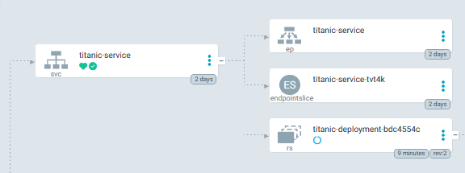

::: {.application}
## Application 22b : Mettre à jour la version en production

Jusqu'à maintenant, on a utilisé le tag *latest* pour définir la version de notre application. En pratique, lorsqu'on passe de la phase de développement à celle de production, on a plutôt envie de versionner proprement les versions de l'application afin de savoir ce qui est déployé. On va pour cela utiliser les ***tags*** avec `Git`, qui vont se propager au nommage de l'image `Docker`.

- Modifier le fichier de CI `docker.yaml` pour assurer la propagation des tags.

<details>
<summary>

Fichier `.github/workflows/docker.yaml`

</summary>

  ```{.yaml filename=".github/workflows/docker.yaml"}
  name: Construction image Docker

  on:
    push:
      branches:
        - main
        - dev
      tags:
        - 'v*.*.*'

  jobs:
    docker:
      runs-on: ubuntu-latest
      steps:
        -
          name: Set up QEMU
          uses: docker/setup-qemu-action@v3
        -
          name: Set up Docker Buildx
          uses: docker/setup-buildx-action@v3

        -
          name: Docker meta
          id: meta
          uses: docker/metadata-action@v5
          with:
            images: username_dockerhub/application #<1>

        -
          name: Login to Docker Hub
          uses: docker/login-action@v3
          with:
            username: ${{ secrets.DOCKERHUB_USERNAME }}
            password: ${{ secrets.DOCKERHUB_TOKEN }}
        -
          name: Build and push
          uses: docker/build-push-action@v5
          with:
            push: true
            tags: ${{ steps.meta.outputs.tags }}
            labels: ${{ steps.meta.outputs.labels }}
  ```
  1. Remplacer par votre compte DockerHub

</details>

- Dans le dépôt de l'application, mettre à jour le code dans `app/api.py` pour changer un élément de l'interface de votre documentation.
Par exemple, mettre en gras un titre.

  ```{.python filename="app/api.py"}
  app = FastAPI(
      title="Démonstration du modèle de prix au m² en petite couronne",
      description=(
          "<b>Estimation du prix au m² des logements</b> à Paris et dans les "
          "départements 92, 93 et 94, à partir des transactions DVF enrichies "
          "par des données socio-économiques Filosofi 🏠<br>"
          "Une version par API pour faciliter la réutilisation du modèle 🚀"
      ),
  )
  ```

- *Commit* et *push* les changements.

- _Tagger_ le commit effectué précédemment et *push* le nouveau tag :

  ```{.bash filename="terminal"}
  git tag -a v0.0.1 -m "Version minimale de l'API avec FastAPI et uv"
  git push --tags
  ```

- Vérifier sur le dépôt `GitHub` de l'application que ce *commit* lance bien un pipeline de CI **associé au tag `v0.0.1`**. Une fois terminé, vérifier sur le `DockerHub` que le tag `v0.0.1` existe bien parmi les tags disponibles de l'image.

La partie CI a correctement fonctionné. Intéressons-nous à présent à la partie CD.

- Sur le dépôt `GitOps`, mettre à jour la version de l'image à déployer en production dans le fichier `deployment/deployment.yaml`

<details>
<summary>

Fichier `deployment/deployment.yaml`

</summary>

  ```{.yaml filename="deployment/deployment.yaml" source-line-numbers="19"}
  apiVersion: apps/v1
  kind: Deployment
  metadata:
    name: dvf-deployment
    labels:
      app: dvf
  spec:
    replicas: 1
    selector:
      matchLabels:
        app: dvf
    template:
      metadata:
        labels:
          app: dvf
      spec:
        containers:
        - name: dvf
          image: username_dockerhub/application:v0.0.1 #<1>
          ports:
          - containerPort: 8000
          env:
          - name: JETON_API
            valueFrom:
              secretKeyRef:
                name: api-jeton
                key: JETON_API
  ```
  1. Remplacer par votre compte DockerHub


</details>

- Après avoir _committé_ et _pushé_, observer dans `ArgoCD` le statut de votre application. Normalement, l'opérateur devrait avoir automatiquement identifié le changement, et mettre à jour le déploiement pour en tenir compte. Si vous êtes allé sur l'interface avant le resynchronisation automatique, vous pouvez cliquer sur `Sync` pour relancer la livraison automatique.



- Vérifier que l'API a bien été mise à jour. Par exemple, le titre de la page `/docs` doit maintenant être le nouveau.

:::




