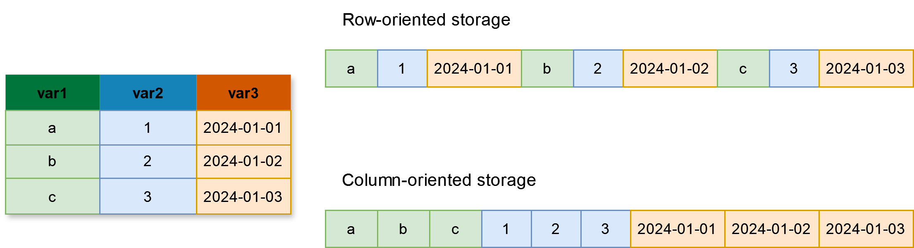

The *big data* phenomenon is now well-documented: the generation and collection of data from a multitude of sources (IoT sensors, daily interactions on social media, online transactions, mobile devices, etc.) drastically increases the volume of data available for analysis. There are many reasons to focus on such data in data science projects: high availability, greater granularity of observed phenomena, and large datasets needed for training increasingly data-hungry models (like LLMs), among others.

Big data is often defined as a situation where the data volume is so large that it can no longer be processed on a single machine. This relative definition may seem reductive but has the advantage of highlighting that a data source, depending on the time and environment, may require different skill sets. Moving to *big data* is not just a matter of scale—it often involves a fundamental shift in the computing infrastructure, with strong implications for the expertise required and the scalability of the data pipelines.

Processing such data introduces new challenges, often summarized as the **"three Vs"**, a widely accepted way to characterize these data sources [@sagiroglu2013big]:

- **Volume**: Massive volumes of data, often far beyond the capabilities of traditional systems. New storage and processing architectures are needed to handle such scales.

- **Velocity**: These data are typically produced at **high frequency, even in real time**. This demands adjustments to architecture and processing methods, such as stream processing.

- **Variety**: These data come from **a wide range of sources and formats**, from structured tables to unstructured data like text, images, or video. The appropriate processing techniques depend heavily on the data type. In this course, we focus on relatively structured data, as they remain central to analytical data science projects.

](/vvv.png){fig-align="center" height=350}

When considering putting a data science project based on large datasets into production, **adopting good development practices is not just recommended—it is essential**. Massive datasets introduce significant complexity at every stage of the data science project lifecycle, from collection and storage to processing and analysis. Systems must be designed not only to handle the current data load but also to be **scalable** for future growth. Good practices enable this scalability by promoting **modular architectures**, reusable code, and technologies suited for large-scale data processing.

To address these challenges, technology choices are crucial. In this course, we will focus on three main aspects to guide those choices: **computing infrastructure**, **data formats** suited for high volumes, and ***frameworks*** (software solutions and their ecosystems) used for data processing.

# Infrastructures

## Evolution of Data Infrastructures

Historically, data has been stored in databases, systems designed to store and organize information. These systems emerged in the 1950s and saw significant growth with relational databases in the 1980s. This technology proved especially effective for organizing corporate “business” data and served as the foundation of *data warehouses*, long considered the standard for data storage infrastructure [@chaudhuri1997overview]. While technical implementations can vary, their core idea is simple: data from various heterogeneous sources is integrated into a relational database system according to business rules via *ETL* (extract-transform-load) processes, making it accessible for a range of uses (statistical analysis, reporting, etc.) using the standardized `SQL` language (@fig-datawarehouse).

](/datawharehouse.png){#fig-datawarehouse fig-align="center"}

In the early 2000s, the growing adoption of *big data* practices exposed the limitations of traditional data warehouses. On one hand, data increasingly came in diverse formats (structured, semi-structured, and unstructured), often evolving as new features were added to data collection platforms. These dynamic, heterogeneous formats fit poorly with the ordered nature of data warehouses, which require schemas to be defined *a priori*. To address this, *data lakes* were developed—systems that allow for the collection and storage of large volumes of diverse data types (@fig-datalake).

](/datalake.png){#fig-datalake fig-align="center"}

Additionally, the enormous size of these data sets made it increasingly difficult to process them on a single machine. This is when Google introduced the `MapReduce` paradigm [@ghemawat2003google; @dean2008mapreduce], which laid the foundation for a new generation of distributed data processing systems. Traditional infrastructures used vertical scalability—adding more powerful or additional resources to a single machine. However, this quickly became expensive and hit hardware limits. Distributed architectures use horizontal scalability: by using many parallel, lower-powered servers and adapting algorithms to this distributed logic, massive datasets can be processed using commodity hardware. This led to the emergence of the `Hadoop` ecosystem, combining complementary technologies: a data lake (`HDFS` - Hadoop Distributed File System), a distributed processing engine (`MapReduce`), and tools for data integration and transformation (@fig-hadoop). This ecosystem expanded with tools like `Hive` (which converts `SQL` queries into distributed `MapReduce` tasks) and `Spark` (which overcomes certain technical limitations of `MapReduce` and provides APIs in multiple languages, including `Java`, `Scala`, and `Python`). Hadoop’s success was profound—it enabled organizations to process petabyte-scale datasets in real-time using widely accessible programming languages.

This technological shift fueled the *big data* revolution, enabling new types of questions to be answered using vast datasets. Philosophically, it marked a shift from collecting only the data needed for known purposes, to storing as much data as possible and evaluating its usefulness later during analysis. This approach is typical of [NoSQL](https://en.wikipedia.org/wiki/NoSQL) environments ("Not only SQL"), where data is stored at each transactional event but in more flexible formats than traditional databases. JSON, derived from web transactions, is especially prominent. Depending on the structure of the data, different tools are used to query it: `ElasticSearch` or `MongoDB` for text data, `Spark` for tabular data, and so on. All these tools share a common trait: they are highly horizontally scalable, making them ideal for server farms.

![Schematic of a Hadoop architecture. Large datasets are split into blocks, and both storage and processing are distributed across multiple compute nodes. Algorithms are adapted to this distributed setup via `MapReduce`: first, a "map" function is applied to each block (e.g., count word frequencies), then a "reduce" step aggregates these results (e.g., compute total frequencies across blocks). Output data is often much smaller than input data and can be brought back locally for further tasks like visualization. Source: [glennklockwood.com](https://www.glennklockwood.com/data-intensive/hadoop/overview.html)](/mapreduce-hdfs.png){#fig-hadoop fig-align="center" height=350}

By the late 2010s, `Hadoop` architectures began to decline in popularity. In traditional Hadoop setups, storage and compute are co-located by design: data segments are processed on the servers where they are stored, avoiding network traffic. This architecture scales linearly, increasing both storage and compute capacity—even if only one is needed. In a provocative article titled "*Big Data is Dead*" [@Tigani_2023], Jordan Tigani (one of the founding engineers of Google BigQuery) argues that this model no longer suits modern data workloads. First, he explains, “in practice, data size grows much faster than compute needs.” Most use cases don’t require querying all stored data—just recent subsets or specific columns. Second, "the big data frontier keeps receding": thanks to more powerful and cheaper servers, fewer workloads require distributed systems (@fig-bigdata-frontier). Additionally, new storage formats (see @sec-new-formats) make data handling more efficient. As a result, properly decoupling storage from compute often leads to simpler, more efficient infrastructures.

](/bigdatafrontier.jpg){#fig-bigdata-frontier fig-align="center" height=350}

## The Role of *Cloud* Technologies

Building on Tigani’s analysis, we observe a growing shift toward more flexible, loosely coupled architectures. The rise of *cloud* technologies has been pivotal in this transition, for several reasons. Technically, network latency is no longer the bottleneck it was during Hadoop’s heyday, making the co-location of compute and storage less necessary. In terms of usage, it’s not just that data volumes are growing—it’s also the **diversity** of data and processing needs that is expanding. Modern infrastructures must support various data formats (from structured tables to unstructured media) and a wide range of compute requirements—from parallel data processing to deep learning on GPUs [@li2020big].

Two cloud-native technologies have become central to this modern flexibility: **containerization** and **object storage**. Containerization ensures reproducibility and portability—crucial for production environments—and will be discussed in the [Portability](/chapters/portability.html) and [Deployment](/chapters/deployment.html) chapters. In this section, we focus on **object storage**, the default standard in modern data infrastructures.

Since containers are *stateless* by nature, a persistent storage layer is needed to store input and output data across computations (@fig-types-storage). In container-based infrastructures, **object storage** has become dominant—popularized by Amazon’s `S3` (Simple Storage Service) [@mesnier2003object; @samundiswary2017object]. To understand its popularity, it's helpful to contrast object storage with other storage types.

There are three main storage models: file systems, block storage, and object storage (@fig-types-storage). File systems organize data in a hierarchical structure—like a traditional desktop environment—but they don’t scale well and require manual access management. Block storage, like that on hard drives, offers fast low-latency access—ideal for databases—but also struggles with scalability and cost. Object storage, on the other hand, breaks data into "objects" stored in a flat namespace and assigned unique IDs and metadata. It removes the need for hierarchical structures, lowering storage costs.

](/types-storage.png){#fig-types-storage fig-align="center" height=250}

Object storage’s characteristics make it ideal for containerized *data science* infrastructures. It’s highly scalable, supports large files, and works well with distributed systems. It also enhances user autonomy by exposing data via APIs like Amazon’s `S3`, allowing direct interaction from code (`R`, `Python`, etc.) and fine-grained access control via tokens. Most importantly, object storage supports **decoupled architectures**, where compute and storage are independent and remotely accessible. This improves flexibility and efficiency.

](/minio-s3.png){#fig-minio-s3 fig-align="center" height=300}

# Data Formats {#sec-new-formats}

Another major dimension to consider for processing massive datasets is how data is stored. Choosing a data format involves balancing several factors, such as the purpose (processing, analysis, dissemination), the target audience (general public, project members, etc.), volume, and interoperability. Traditional formats like CSV, JSON, and XML are widely used due to their convenience: they are plain text formats, making them easily viewable in any text editor — they are considered *human-readable*. Additionally, they are naturally interoperable: plain text can be read by almost any programming language, and most libraries provide built-in support for reading these formats. However, these formats quickly show their limitations when dealing with massive datasets. The lack of compression results in high disk usage, and their row-based representation (@fig-columnar-storage) on disk and in memory makes them inefficient — you often need to load the entire file into memory to perform operations on specific rows or columns.

One of the major innovations in the data ecosystem over the past decade is the emergence of data formats that address the limitations of traditional formats. The most popular and now standard format for data storage is `Apache Parquet`. It offers several features that make it especially well-suited for *data science* applications. First, it is a compressed format, making it ideal for storing large datasets. Depending on data structure, it’s not uncommon for a dataset in `Parquet` format to take up 10 times less space than its `CSV` equivalent. Second, `Parquet` is interoperable: files in this format can be queried not only with common languages like `Python`, `R`, or `SQL`, but also with big data processing tools like `Spark`.

However, the key reason for `Parquet`’s widespread adoption in *data science* is its **read performance**. Intuitively, one might expect that a compressed format would be slower to read than a text format like `CSV`—after all, decompressing takes time. But `Parquet` uses highly optimized compression that actually **outperforms** reading from a plain CSV file. A crucial feature of `Parquet` that contributes to this performance is that it is **column-oriented**, meaning data is stored by columns rather than by rows as in traditional text formats (@fig-columnar-storage). This makes it highly efficient for analytical workloads (also known as OLAP — *Online Analytical Processing*), which often involve selecting specific columns, computing derived variables, and aggregating data by groups. Row-based formats like CSV require reading the entire dataset into memory to execute such queries. In contrast, columnar formats allow reading only the relevant columns, significantly reducing read and compute times for analytics tasks [@abdelaziz2023optimizing]. In practice, popular columnar formats like `Parquet` use a hybrid approach: they are mainly column-oriented, but also include row-grouping techniques to further optimize filtering operations.

{#fig-columnar-storage}

Another important feature of the `Parquet` format is its **native support for partitioned files**, which means a dataset can be split across multiple files based on one or more partition keys. In most statistical processing, the entire dataset isn't required at once — you typically filter by geographic area, time window, etc. If all data is stored in a single file, you’d still need to load all rows — at least the relevant columns — into memory to perform such filtering. With `Parquet`, datasets can be partitioned by frequently used filters — similar to indexes in a `SQL` database — enabling much faster and more efficient queries (@fig-parquet-partitions). This feature makes `Parquet` especially well-suited for analytical tasks common in *data science* [@dondon2023quels].

{#fig-parquet-partitions fig-align="center" height=300}

# Processing *Frameworks*

The `Parquet` format makes tabular data storage significantly more efficient. But to fully benefit from this structure, one must also consider the next step: in-memory data processing.

Two major tools have emerged in recent years to address this need. The first is [Apache Arrow](https://arrow.apache.org/), an in-memory tabular data format interoperable across many languages (`Python`, `R`, `Java`, etc.). The second is [`DuckDB`](https://duckdb.org/), a portable and interoperable database engine capable of querying highly diverse data sources (@fig-duckdb-multisrc). While technically quite different in their implementations, both tools offer similar advantages and performance gains. First, both are column-oriented and thus work synergistically with the `Parquet` format by preserving the benefits of columnar storage in memory (@fig-arrow-memory).

](/arrow-memory.png){#fig-arrow-memory fig-align="center" height=400}

Moreover, both `Arrow` and `DuckDB` drastically improve query performance through *lazy evaluation*. While most programming languages execute data operations sequentially — e.g., select columns, filter rows, compute new variables, then perform aggregations — `Arrow` and `DuckDB` use a precomputed execution plan that globally optimizes the processing chain. This approach not only makes computations faster, but also more efficient, as only the necessary data is retrieved and processed. These innovations make it feasible to work with datasets that exceed the available RAM on a machine.

](/duckdb-multisrc.png){#fig-duckdb-multisrc fig-align="center" height=400}

The best way to appreciate the benefits of the `Parquet` format is to test it and compare it against the same data stored as CSV, as shown in @fig-tableau-parquet. The applications below illustrate the previously mentioned concepts (*lazy evaluation*, partitioning, etc.) and demonstrate the usability of the `Arrow` and `DuckDB` ecosystems through simple examples. The [capstone application](/chapters/application.qmd) covers `Parquet` in less detail.

{#fig-tableau-parquet width="80%"}

# Applications

Throughout this application, we will explore how to use the `Parquet` format as efficiently as possible. To compare different formats and usage methods, we will **compare execution time and memory usage for a standard query**. Let's start with a small dataset example to compare the `CSV` and `Parquet` formats.

To do this, we need to retrieve some data in `Parquet` format. We suggest using detailed and anonymized population census data from France: about 20 million rows and 80 columns. The code to retrieve the data is given below

```{python}
#| eval: false
#| code-fold: true
import pyarrow.parquet as pq
import pyarrow as pa
import os

# Définir le fichier de destination
filename_table_individu = "data/RPindividus.parquet"

# Copier le fichier depuis le stockage distant (remplacer par une méthode adaptée si nécessaire)
os.system("mc cp s3/projet-formation/bonnes-pratiques/data/RPindividus.parquet data/RPindividus.parquet") #<1>

# Charger le fichier Parquet
table = pq.read_table(filename_table_individu)
df = table.to_pandas()

# Filtrer les données pour REGION == "24"
df_filtered = df.loc[df["REGION"] == "24"]

# Sauvegarder en CSV
df_filtered.to_csv("data/RPindividus_24.csv", index=False)

# Sauvegarder en Parquet
pq.write_table(pa.Table.from_pandas(df_filtered), "data/RPindividus_24.parquet")
```
1. This line of code uses the Minio Client utility available on the `SSPCloud`. If you are not on this infrastructure, you can refer to the dedicated warning

::: {.callout-important collapse="true"}
## If you are not on `SSPCloud`

You will need to replace the line

```{.python}
os.system("mc cp s3/projet-formation/bonnes-pratiques/data/RPindividus.parquet data/RPindividus.parquet")
```

which uses the `mc` command-line tool, with a line of code that downloads this file from the URL [https://projet-formation.minio.lab.sspcloud.fr/bonnes-pratiques/data/RPindividus.parquet](https://projet-formation.minio.lab.sspcloud.fr/bonnes-pratiques/data/RPindividus.parquet).

There are several ways to do this. For example, you can use pure `Python` with `requests`. If you have `curl` installed, you can also use it. Via `Python`, this would be the command `os.system("curl -o data/RPindividus.parquet https://projet-formation/bonnes-pratiques/data/RPindividus.parquet")`.

:::

These exercises will use `Python` decorators, i.e., functions that override the behavior of another function. In this case, we will create a function that runs a chain of operations and override it with another one that monitors memory usage and execution time.

:::{.application collapse="false"}
# Part 1: From `CSV` to `Parquet`

* Create a notebook `benchmark_parquet.ipynb` to perform various performance comparisons for the application.
* Let's create our decorator, responsible for benchmarking the `Python` code:

  ```{python}
  #| eval: false
  #| code-fold: true
  #| code-summary: "Dérouler pour retrouver le code du décorateur permettant de mesurer la performance"
  import time
  from memory_profiler import memory_usage
  from functools import wraps
  import warnings

    def convert_size(size_bytes):
    if size_bytes == 0:
        return "0B"
    size_name = ("B", "KB", "MB", "GB", "TB", "PB", "EB", "ZB", "YB")
    i = int(math.floor(math.log(size_bytes, 1024)))
    p = math.pow(1024, i)
    s = round(size_bytes / p, 2)
    return "%s %s" % (s, size_name[i])

    # Decorator to measure execution time and memory usage
    def measure_performance(func, return_output=False):
        @wraps(func)
        def wrapper(return_output=False, *args, **kwargs):
            warnings.filterwarnings("ignore")
            start_time = time.time()
            mem_usage = memory_usage((func, args, kwargs), interval=0.1)
            end_time = time.time()
            warnings.filterwarnings("always")

            exec_time = end_time - start_time
            peak_mem = max(mem_usage)  # Peak memory usage
            exec_time_formatted = f"\033[92m{exec_time:.4f} sec\033[0m"
            peak_mem_formatted = f"\033[92m{convert_size(1024*peak_mem)}\033[0m"

            print(f"{func.__name__} - Execution Time: {exec_time_formatted} | Peak Memory Usage: {peak_mem_formatted}")
            if return_output is True:
                return func(*args, **kwargs)

        return wrapper
  ```


* The following query calculates the data needed to build a population pyramid for a given department, using the census `CSV` file. Test it in your notebook:
  ```{python}
  #| eval: false
  #| code-fold: true
  #| code-summary: "Dérouler pour récupérer le code de lecture du CSV"
  import pandas as pd

  # Charger le fichier CSV
  df = pd.read_csv("data/RPindividus_24.csv")
  res = (
      df.loc[df["DEPT"] == 36]
      .groupby(["AGED", "DEPT"])["IPONDI"]
      .sum().reset_index()
      .rename(columns={"IPONDI": "n_indiv"})
  )
  ```

* Repeat this code to encapsulate these operations in a `process_csv_appli1` function:

  ```{python}
  #| eval: false
  #| code-fold: true
  #| code-summary: "Dérouler pour récupérer le code pour mesurer les performances de la lecture en CSV"

  # Apply the decorator to functions
  @measure_performance
  def process_csv_appli1(*args, **kwargs):
      df = pd.read_csv("data/RPindividus_24.csv")
      return (
          df.loc[df["DEPT"] == 36]
          .groupby(["AGED", "DEPT"])["IPONDI"]
          .sum().reset_index()
          .rename(columns={"IPONDI": "n_indiv"})
      )
  ```

* Run `process_csv_appli1()` and `process_csv_appli1(return_output=True)`

* Following the same model, build a `process_parquet_appli1` function based this time on the file `data/RPindividus_24.parquet` loaded with Pandas’ [read_parquet](https://pandas.pydata.org/docs/reference/api/pandas.read_parquet.html) function.
* Compare the performance (execution time and memory allocation) of these two methods using the function.

```{python}
#| eval: false
#| code-fold: true
#| code-summary: "Code complet de l'application"
import math
import pandas as pd
import time
from memory_profiler import memory_usage
from functools import wraps
import warnings

def convert_size(size_bytes):
   if size_bytes == 0:
       return "0B"
   size_name = ("B", "KB", "MB", "GB", "TB", "PB", "EB", "ZB", "YB")
   i = int(math.floor(math.log(size_bytes, 1024)))
   p = math.pow(1024, i)
   s = round(size_bytes / p, 2)
   return "%s %s" % (s, size_name[i])

# Decorator to measure execution time and memory usage
def measure_performance(func, return_output=False):
    @wraps(func)
    def wrapper(return_output=False, *args, **kwargs):
        warnings.filterwarnings("ignore")
        start_time = time.time()
        mem_usage = memory_usage((func, args, kwargs), interval=0.1)
        end_time = time.time()
        warnings.filterwarnings("always")

        exec_time = end_time - start_time
        peak_mem = max(mem_usage)  # Peak memory usage
        exec_time_formatted = f"\033[92m{exec_time:.4f} sec\033[0m"
        peak_mem_formatted = f"\033[92m{convert_size(1024*peak_mem)}\033[0m"

        print(f"{func.__name__} - Execution Time: {exec_time_formatted} | Peak Memory Usage: {peak_mem_formatted}")
        if return_output is True:
            return func(*args, **kwargs)

    return wrapper

# Apply the decorator to functions
@measure_performance
def process_csv(*args, **kwargs):
    df = pd.read_csv("data/RPindividus_24.csv")
    return (
        df.loc[df["DEPT"] == 36]
        .groupby(["AGED", "DEPT"])["IPONDI"]
        .sum().reset_index()
        .rename(columns={"IPONDI": "n_indiv"})
    )

@measure_performance
def process_parquet(*args, **kwargs):
    df = pd.read_parquet("data/RPindividus_24.parquet")
    return (
        df.loc[df["DEPT"] == "36"]
        .groupby(["AGED", "DEPT"])["IPONDI"]
        .sum().reset_index()
        .rename(columns={"IPONDI": "n_indiv"})
    )

process_csv()
process_parquet()
```


:::

_❓️ What seems to be the limitation of the `read_parquet` function?_

We already save a significant amount of time on reading, but we don't fully benefit from the optimizations enabled by `Parquet` because we immediately transform the data into a `Pandas` `DataFrame` after reading it. This means we are not using one of `Parquet`’s key features that explains its excellent performance: _predicate pushdown_, which optimizes processing by applying filters on columns as early as possible to retain only those actually used in the operation.

::: {.application collapse="false"}
## Part 2: Leveraging *lazy evaluation* and `Arrow` or `DuckDB` optimizations

The previous section showed a **significant time gain** when switching from `CSV` to `Parquet`. However, **memory usage remained very high**, even though only a small portion of the file was actually used.

In this section, we'll explore how to use ***lazy evaluation*** and **execution plan optimizations** performed by `Arrow` to fully harness the power of the `Parquet` format.

* Open the file `data/RPindividus_24.parquet` with [pyarrow.dataset](https://arrow.apache.org/docs/python/dataset.html). Check the class of the resulting object.
* Try the code below to read a data sample:

```{python}
#| eval: false
(
    dataset.scanner()
    .head(5)
    .to_pandas()
)
```

Do you understand the difference compared to before? Look at the documentation for the `to_table` method: do you grasp its purpose?

* Build a function `summarize_parquet_arrow` (or `summarize_parquet_duckdb`) which now imports the data using the [`pyarrow.dataset`](https://arrow.apache.org/docs/python/dataset.html) function (or with `DuckDB`) and performs the desired aggregation.
* Compare the performance (execution time and memory allocation) of the three methods (`Parquet` read and processed with `Pandas`, `Arrow`, and `DuckDB`) using our function.

```{python}
#| eval: false
#| code-fold: true
#| code-summary: "Code complet de l'application"

import duckdb
import pyarrow.dataset as ds

@measure_performance
def summarize_parquet_duckdb(*args, **kwargs):
    con = duckdb.connect(":memory:")
    query = """
    FROM read_parquet('data/RPindividus_24.parquet')
    SELECT AGED, DEPT, SUM(IPONDI) AS n_indiv
    GROUP BY AGED, DEPT
    """

    return (con.sql(query).to_df())

@measure_performance
def summarize_parquet_arrow(*args, **kwargs):

    dataset = ds.dataset("data/RPindividus_24.parquet", format="parquet")
    table = dataset.to_table()
    grouped_table = (
        table
        .group_by(["AGED", "DEPT"])
        .aggregate([("IPONDI", "sum")])
        .rename_columns(["AGED", "DEPT", "n_indiv"])
        .to_pandas()
    )

    return (
        grouped_table
    )

process_parquet()
summarize_parquet_duckdb()
summarize_parquet_arrow()
```


:::

With lazy evaluation, the process unfolds in multiple stages:

* `Arrow` or `DuckDB` receives instructions, optimizes them, and executes the queries
* Only the output data from this chain is sent back to `Python`


## Application 3 {.smaller}

::: {.application collapse="false"}
# Part 3a: What if we filter rows?

Add a row filtering step in our queries:

* With `DuckDB`, modify the query with `WHERE DEPT IN ('18', '28', '36')`
* With `Arrow`, modify the `to_table` step as follows: `dataset.to_table(filter=pc.field("DEPT").isin(['18', '28', '36']))`

```{python}
#| eval: false
#| code-fold: true
#| code-summary: "Correction de cet exercice"
import pyarrow.dataset as ds
import pyarrow.compute as pc
import duckdb

@measure_performance
def summarize_filter_parquet_arrow(*args, **kwargs):

    dataset = ds.dataset("data/RPindividus.parquet", format="parquet")
    table = dataset.to_table(filter=pc.field("DEPT").isin(['18', '28', '36']))
    grouped_table = (
        table
        .group_by(["AGED", "DEPT"])
        .aggregate([("IPONDI", "sum")])
        .rename_columns(["AGED", "DEPT", "n_indiv"])
        .to_pandas()
    )

    return (
        grouped_table
    )

@measure_performance
def summarize_filter_parquet_duckdb(*args, **kwargs):
    con = duckdb.connect(":memory:")
    query = """
    FROM read_parquet('data/RPindividus_24.parquet')
    SELECT AGED, DEPT, SUM(IPONDI) AS n_indiv
    WHERE DEPT IN ('11','31','34')
    GROUP BY AGED, DEPT
    """

    return (con.sql(query).to_df())


summarize_filter_parquet_arrow()
summarize_filter_parquet_duckdb()
```


:::

*❓️ Why don’t we save time with row filters (or even lose time), unlike with column filters?*

Data is not organized in row blocks the way it is in column blocks. Fortunately, there’s a way around this: partitioning!

::: {.application collapse="false"}
# Part 3: Partitioned `Parquet`

*Lazy evaluation* and `Arrow` optimizations already bring considerable performance gains. But we can do even better! When we know that data will regularly be **filtered based on a specific variable**, it is a good idea to **partition** the `Parquet` file by that variable.

1. Browse the documentation for [`pyarrow.parquet.write_to_dataset`](https://arrow.apache.org/docs/python/parquet.html#writing-to-partitioned-datasets) to understand how to specify a partitioning key when writing a `Parquet` file. Several methods are possible.

2. Import the full census individual table from `"data/RPindividus.parquet"` using [`pyarrow.dataset.dataset`](https://arrow.apache.org/docs/python/generated/pyarrow.dataset.dataset.html) and export it as a partitioned table to `"data/RPindividus_partitionne.parquet"`, partitioned by region (`REGION`) and department (`DEPT`).

3. Examine the file tree structure of the exported table to see how the partitioning was applied.

4. Modify the import, filtering, and aggregation functions using `Arrow` or `DuckDB` to now use the partitioned `Parquet` file. Compare this to using the non-partitioned file.

```{python}
#| eval: false
#| code-fold: true
#| code-summary: "Answer to question 2 (writing the partitioned Parquet)"
import pyarrow.parquet as pq
dataset = ds.dataset(
    "data/RPindividus.parquet", format="parquet"
).to_table()

pq.write_to_dataset(
    dataset,
    root_path="data/RPindividus_partitionne",
    partition_cols=["REGION", "DEPT"]
)
```

```{python}
#| eval: false
#| code-fold: true
#| code-summary: "Correction de la question 4 (lecture du Parquet partitionné)"
import pyarrow.dataset as ds
import pyarrow.compute as pc
import duckdb

@measure_performance
def summarize_filter_parquet_partitioned_arrow(*args, **kwargs):

    dataset = ds.dataset("data/RPindividus_partitionne/", partitioning="hive")
    table = dataset.to_table(filter=pc.field("DEPT").isin(['18', '28', '36']))

    grouped_table = (
        table
        .group_by(["AGED", "DEPT"])
        .aggregate([("IPONDI", "sum")])
        .rename_columns(["AGED", "DEPT", "n_indiv"])
        .to_pandas()
    )

    return (
        grouped_table
    )

@measure_performance
def summarize_filter_parquet_complete_arrow(*args, **kwargs):

    dataset = ds.dataset("data/RPindividus.parquet")
    table = dataset.to_table(filter=pc.field("DEPT").isin(['18', '28', '36']))

    grouped_table = (
        table
        .group_by(["AGED", "DEPT"])
        .aggregate([("IPONDI", "sum")])
        .rename_columns(["AGED", "DEPT", "n_indiv"])
        .to_pandas()
    )

    return (
        grouped_table
    )


@measure_performance
def summarize_filter_parquet_complete_duckdb(*args, **kwargs):
    con = duckdb.connect(":memory:")
    query = """
    FROM read_parquet('data/RPindividus.parquet')
    SELECT AGED, DEPT, SUM(IPONDI) AS n_indiv
    WHERE DEPT IN ('11','31','34')
    GROUP BY AGED, DEPT
    """

    return (con.sql(query).to_df())


@measure_performance
def summarize_filter_parquet_partitioned_duckdb(*args, **kwargs):
    con = duckdb.connect(":memory:")
    query = """
    FROM read_parquet('data/RPindividus_partitionne/**/*.parquet', hive_partitioning = True)
    SELECT AGED, DEPT, SUM(IPONDI) AS n_indiv
    WHERE DEPT IN ('11','31','34')
    GROUP BY AGED, DEPT
    """

    return (con.sql(query).to_df())


summarize_filter_parquet_complete_arrow()
summarize_filter_parquet_partitioned_arrow()
summarize_filter_parquet_complete_duckdb()
summarize_filter_parquet_partitioned_duckdb()
```


:::

*❓️ When making data available in `Parquet` format, how should you choose the partitioning key(s)? What limitation should be kept in mind?*

## To go further

* The [training on good practices with `R` and `Git`](https://inseefrlab.github.io/formation-bonnes-pratiques-git-R/) developed by Insee, with content very similar to what’s presented in this chapter.
* A [workshop](https://linogaliana.github.io/parquet-recensement-tutomate/) on the `Parquet` format and `DuckDB` ecosystem for EHESS, with `R` and `Python` examples using the same data source as this application.
* The [getting started guide](https://ssphub.netlify.app/post/parquetrp/) for census data in `Parquet` format with examples using `DuckDB` in WASM (directly in the browser, without `R` or `Python` installation).
