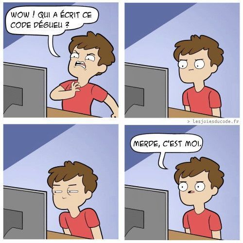

This chapter introduces the topic of code quality,  
the first level in the hierarchy of best practices. It outlines  
why code quality matters, general principles for improving it,  
and a few simple tools or practices to enhance code quality.  
These are explored further in the [running example](/chapters/application.qmd).

# Introduction

{fig-align="center"}

## Why Readable and Maintainable Code Matters

> _"The code is read much more often than it is written."_
>
> Guido Van Rossum[^1]

[^1]: Guido Van Rossum is the creator of , which makes him a voice worth listening to.

When getting started with *data science*, it’s natural to think of code in a purely functional way: “I want to complete a given task—say, run a classification algorithm—so I’ll piece together some code, often found online, in a notebook until the task is done.” The project’s structure doesn’t matter much, as long as it loads the necessary data.

While this minimalist and flexible mindset works well during the learning phase, it’s essential to move past it as you progress—especially if you’re building professional or collaborative projects. Otherwise, you’ll likely end up __with code that’s hard to maintain or improve—and that will eventually be abandoned__.

It’s important to choose, among many ways to solve a problem, a solution that can be understood by others who speak the same programming language. Code is read far more than it’s written—it’s primarily a __communication tool__. Moreover, maintaining code typically takes more effort than writing it in the first place. That’s why thinking ahead about code quality and project structure is critical to long-term maintainability.

To improve communication and reduce the pain of working with unclear code, developers have attempted—sometimes informally, sometimes through institutions—to define conventions. These depend on the language but are based on principles that apply universally to code-based projects.

## Why Follow Conventions?

`Python` is a very __readable__ language.
With a bit of care—naming things well, managing dependencies,
and structuring code properly—you can often understand a script
without running it. This is one of Python’s biggest strengths,
enabling fast learning and easy understanding of other people's code.

The Python community has developed a set of widely accepted standards,
called `PEPs` (Python Enhancement Proposals),
that serve as the foundation of the ecosystem.
The two most well-known are:

- __[`PEP8`](https://peps.python.org/pep-0008/)__, which defines code style conventions;
- __[`PEP257`](https://peps.python.org/pep-0257/)__, which outlines conventions for documentation (_docstrings_).

These conventions go beyond syntax. Several standards for project organization have also emerged, which we’ll explore in the [next chapter](/chapters/projects-architecture.html).

:::: {.callout-note collapse="true"}
## Comparison with 

In the  ecosystem, formalization has been less structured. The language is more permissive than `Python` in some ways[^2]. Still, some style standards have emerged, including:

- the [_tidyverse style guide_](https://style.tidyverse.org/googl),
- the [_Google R style guide_](https://google.github.io/styleguide/Rguide.html),
- and the [MLR style guide](https://github.com/mlr-org/mlr3/wiki/Style-Guide#theoretical-style-guide)...

For further learning in :

* The Insee training on [best practices with `Git` and ](https://inseefrlab.github.io/formation-bonnes-pratiques-git-R/), which aligns closely with this course;
* Additional guidance in the [collaborative `utilitR` documentation](https://www.book.utilitr.org/02_bonnes_pratiques/01-qualite-code);
* [This blog post](https://blog.r-hub.io/2022/03/21/code-style/) that links to various resources on the subject.
::::

[^2]: For example, in , you can use `<-` or `=` for assignment, and the language won’t complain about poor indentation...

These conventions are somewhat arbitrary—it’s natural to prefer some styles over others.

They’re also not set in stone. Languages and practices evolve, which means conventions must adapt. Still, adopting the recommended habits—when possible—will make your code easier for the community to understand, increase your chances of getting help, and make future maintenance easier.

There are many coding style philosophies, but the most important principle is __consistency__:
If you choose a convention—say, _snake_case_ (`my_function_name`) over _camelCase_ (`myFunctionName`)—then stick with it.

# Principle 1️⃣: Adopt Community Standards

In line with the idea of best practices as a **continuum** introduced in the [introduction](/chapters/introduction.qmd), it's not necessarily advisable to apply all the recommendations in this chapter to every project. In some cases, the marginal cost of implementing certain practices may outweigh the benefits.

Instead, we recommend thinking of these best practices as habits to be acquired gradually, through a back-and-forth between theory and practice. The tools we’ll introduce are here to help accelerate the adoption of best practices.

This chapter is not meant to be exhaustive. It highlights some useful resources while offering practical advice. Memorizing every rule or constantly switching between your code and rulebooks would be tedious.

To draw a parallel with natural language: we don’t always have a dictionary at hand. Text editors and smartphones come with built-in spellcheckers that identify—and sometimes fix—errors in real time.

## A Good IDE: The First Step Toward Quality

Without automated code formatting tools, adopting best practices would be time-consuming and difficult to implement daily. Tools that provide diagnostics or automatically format code are incredibly useful. They allow developers to meet minimum quality standards almost instantly, saving time throughout a *data science* project. These tools are a prerequisite for production deployment, which we’ll discuss later.

The first step toward best practices is choosing a suitable development environment. `VSCode` is an excellent IDE, as we’ll explore in the [practical section](/chapters/application.qmd). It offers autocompletion, built-in diagnostics (unlike `Jupyter`), and a wide array of extensions to expand functionality:


However, IDE-level tools are not enough. They require manual interaction, which can be time-consuming and difficult to apply consistently. Fortunately, we also have automated tools for diagnostics and formatting.

### Automated Tools for Code Diagnostics and Formatting

Since `Python` is the primary tool of thousands of *data scientists*, many tools have been developed to reduce the time needed to create a functional project. These tools boost productivity, reduce repetitive tasks, and improve project quality through diagnostics or even automatic fixes.

There are two main types of tools:

1. **Linters**: programs that check whether code formally adheres to a given _guidestyle_
   + They report issues but do not fix them
2. **Formatters**: programs that automatically rewrite code to follow a specific _guidestyle_
   + They modify the code directly

:::: {.callout-tip collapse="true"}
## Examples

- Issues that a linter can catch:
  + long or poorly indented lines, unbalanced parentheses, poorly named functions…
- Issues that a linter typically won’t catch:
  + incorrect function usage, mis-specified arguments, incoherent structure, insufficient documentation…
::::

### Linters to Identify Bad Coding Habits

Linters assess code quality and its potential to trigger explicit or silent errors.

Examples of issues linters can catch include:

* usage of undefined variables (errors)
* unused variables (unnecessary code)
* poor code organization (risk of bugs)
* violations of code style guidelines
* syntax errors (e.g., typos)

Most development tools offer built-in diagnostics (and sometimes suggestions). You may need to enable them in the settings, as they’re often disabled by default to avoid overwhelming beginners.

However, if you don't fix issues as you go, the backlog of changes can become overwhelming.

In `Python`, the two most common linters are [`PyLint`](https://pylint.readthedocs.io/en/latest/) and [`Flake8`](https://flake8.pycqa.org/en/latest/). In this course, we’ll use `PyLint` for its practicality and pedagogy. It can be run from the command line as follows:

````bash
pip install pylint
pylint myscript.py   # for a single file
pylint src           # for all files in the 'src' folder
````

:::: {.callout-tip collapse="true"}
One of the nice features of `PyLint` is that it gives a score, which is quite informative. We’ll use this in the running project to track how each step improves code quality.

You can also set up [_pre-commit hooks_](https://pylint.readthedocs.io/en/latest/user_guide/installation/pre-commit-integration.html) to block commits that don’t meet a minimum score.
::::

### Formatters for Bulk Code Cleanup

A formatter rewrites code directly—like a spellchecker, but for style. It can make substantial changes to improve readability.

The most widely used formatter is [`Black`](https://black.readthedocs.io/en/stable/). More recently, [`Ruff`](https://github.com/astral-sh/ruff)—a hybrid linter/formatter—has gained popularity. It builds on `Black` while integrating diagnostics from other packages.

:::: {.callout-note collapse="true"}
If your project uses `Black`, you can add a badge to the `README` on GitHub:

[](https://github.com/psf/black)
::::

It’s quite instructive to review code after formatting—it helps identify and correct stylistic habits. You’ll likely notice some rules that contradict your current habits. Try applying these new rules incrementally. Once they become second nature, revisit the guide and tackle the next set of improvements. This step-by-step approach helps raise code quality without getting bogged down in micro-details that distract from the bigger project goals.

## Sharing: A Path to Better Code Quality

### Open Source as a Quality Driver

By sharing your code on open-source platforms (see [Git chapter](/chapters/git.qmd)), you may receive suggestions or even contributions from other users. But the benefits of openness go further. Public code tends to be better written, better documented, and more thoughtfully structured—often because authors want to avoid public embarrassment! Even without external feedback, sharing code encourages higher quality.

### Code Review

Code review borrows from academic _peer review_ to improve the quality of `Python` code. In a review, one or more developers read and evaluate code written by someone else to identify errors and suggest improvements.

Benefits include:

- catching bugs before they escalate
- ensuring consistent style and structure
- enforcing best practices
- identifying code that could be refactored for clarity or maintainability

It’s also a great way to share knowledge: senior developers can help junior ones grow by reviewing their work.

Platforms like `GitHub`  and `GitLab`  offer convenient code review features: inline discussions, suggestions, etc.

# Principle 2️⃣: Favour a Modular Structure

## Objectives

- Encourage __conciseness__ to reduce the risk of error and make the process clearer;
- Improve __readability__, which is essential to make the process understandable by others but also for yourself when revisiting an old script;
- Reduce __redundancy__, which simplifies code (the _don't repeat yourself_ paradigm);
- Minimize the risk of __errors due to copy/paste__.

## Advantages of Functions

Functions have many advantages over long scripts:

- Limit the risk of errors caused by copy/paste;
- Make the code more readable and compact;
- Only one place to modify the code if the processing changes;
- Facilitate code reuse and documentation!

::: {.callout-important}
## Golden Rule

You should use a [**function**]{.red2} whenever a piece of code is used more than twice ([**_don't repeat yourself_ (DRY)**]{.red2}).
:::

::: {.callout-tip}
## Rules for Writing **Effective** Functions

- One task = one function;
- A complex task = a sequence of functions, each performing a simple task;
- Limit the use of global variables.

:::

Regarding package installation, as we will see in the [Project Structure](/chapters/projects-architecture.html) and [Portability](/chapters/portability.qmd) sections, this should not be managed inside the script, but in a separate element related to the project's execution environment[^environnement]. Those sections also provide practical advice on handling API or database tokens, which __should never be written in the code__.

[^environnement]: We will present the two main approaches in `Python`, their similarities and differences: virtual environments (managed by a `requirements.txt` file) and conda environments (managed by an `environment.yml` file).

Overly long scripts are not a best practice. It is better to divide all scripts executing a production chain into _"monads"_, i.e., small coherent units. Functions are a key tool for this purpose (they help reduce redundancy and are a preferred tool for documenting code).

::: {.callout-caution collapse="true"}
## Example: Prefer List Comprehensions

In `Python`, it is recommended to prefer list comprehensions over indented `for` loops. The latter are generally less efficient and involve a larger number of code lines, whereas list comprehensions are much more concise:

```python
liste_nombres = range(10)

# very bad
y = []
for x in liste_nombres:
    if x % 2 == 0:
        y.append(x*x)

# better
y = [x*x for x in liste_nombres if x % 2 == 0]
```

:::

### Programming Advice

In the Python programming world, there are two main paradigms:

- __Functional programming__: builds code by chaining functions, i.e., more or less standardized operations;
- __Object-Oriented Programming (OOP)__: builds code by defining objects of a given _class_ with _attributes_ (intrinsic features) and custom _methods_ to perform class-specific operations.

<details>
<summary>
Example comparing the two paradigms
</summary>

Thanks _ChatGPT_ for the example:

```{python}
#| eval: true
class AverageCalculator:
    def __init__(self, numbers):
        self.numbers = numbers

    def calculate_average(self):
        return sum(self.numbers) / len(self.numbers)

# Usage
calculator = AverageCalculator([1, 2, 3, 4, 5])
print("Average (OOP):", calculator.calculate_average())

def calculate_average(numbers):
    return sum(numbers) / len(numbers)

# Usage
numbers = [1, 2, 3, 4, 5]
print("Average (FP):", calculate_average(numbers))
```

</details>

Functional programming is more intuitive than OOP and often allows for quicker code development. OOP is a more formalist approach, useful when functions need to adapt to the input object type (e.g., loading different model weights depending on the model type in [`Pytorch`](https://pytorch.org/vision/0.9/models.html)). It avoids 🍝 _spaghetti code_ that’s hard to debug.

However, one should remain pragmatic. OOP can be more complex to implement than functional programming. In many cases, well-written functional code is sufficient. For large projects, adopting a __defensive programming__ approach is helpful — a precautionary strategy in the functional paradigm that anticipates and manages unexpected situations (e.g., wrong argument type or structure).

::: {.callout-note}

## Spaghetti Code

“Spaghetti code” refers to programming style that leads to tangled code due to excessive use of conditions, exceptions, and complex event handling. It becomes almost impossible to trace the cause of errors without stepping through every line of code — and there are many, due to poor practices.

Spaghetti code prevents determining who, what, and how something happens, making updates time-consuming since one must follow the chain of references line by line.

:::

::: {.callout-tip collapse="true"}
## A Progressive Example

💡 Suppose we have a dataset that uses `−99` to represent missing values. We want to replace all `−99` with `NA`.

```python
np.random.seed(1234)
a = np.random.randint(1, 10, size = (5,6))
df = np.insert(
    a,
    np.random.choice(len(a), size=6),
    -99,
)
df = pd.DataFrame(df.reshape((6,6)), columns=[chr(x) for x in range(97, 103)])
```

First attempt:

```python
df2 = df.copy()
df2.loc[df2['a'] == -99,'a'] = np.nan
df2.loc[df2['b'] == -99,'b'] = np.nan
df2.loc[df2['c'] == -99,'c'] = np.nan
df2.loc[df2['d'] == -99,'d'] = np.nan
df2.loc[df2['e'] == -98,'e'] = np.nan
df2.loc[df2['f'] == -99,'e'] = np.nan
```

What’s wrong here?

<details>
<summary>
Hint 💡 Look at columns `e` and `g`.
</summary>
Two copy-paste errors:
- `-98` instead of `-99`;
- `'e'` instead of `'f'` in the last line.
</details>

Next improvement — using a function:

```python
def fix_missing(x: pd.Series):
    x[x == -99] = np.nan
    return x

df2 = df.copy()
df2['a'] = fix_missing(df['a'])
df2['b'] = fix_missing(df['b'])
...
```

Still repetitive and error-prone with column names.

Best version — apply function across all columns:

```python
df2 = df.copy()
df2 = df2.apply(fix_missing)
```

Now the code is:
1. Concise;
2. Robust to data structure changes;
3. Free from hard-coded mistakes;
4. Easily generalizable — e.g., apply only on selected columns:

```python
df2[['a','b','e']] = df2[['a','b','e']].apply(fix_missing)
```

:::

Resources like the [Hitchhiker's Guide to Python](https://docs.python-guide.org/writing/style/) and [this blog post](https://towardsdatascience.com/the-zen-of-python-a-guide-to-pythons-design-principles-93f3f76d088a) illustrate these design principles well.

::: {.callout-note collapse="true"}
## The Zen of Python

Written by Tim Peters in 2004, this set of aphorisms embodies Python’s design philosophy:

```python
import this
```

```
The Zen of Python, by Tim Peters

Beautiful is better than ugly.
Explicit is better than implicit.
Simple is better than complex.
...
Namespaces are one honking great idea -- let's do more of those!
```

:::
