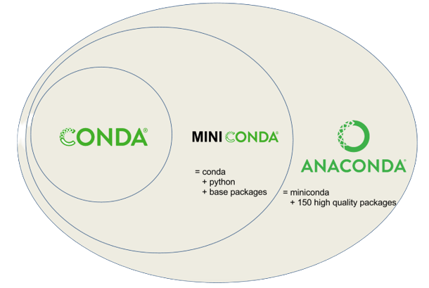
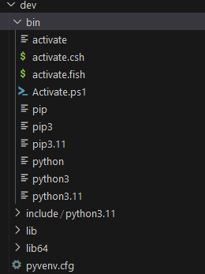

# Introduction: The Notion of Portability

In previous chapters, we explored a set of best practices that significantly improve project quality: making code more readable, adopting a standardized and scalable project structure, and properly versioning code on a `GitHub`  repository.

Once these best practices are applied, the project seems highly shareable — at least in theory. In practice, things are often more complicated: chances are that if you try to run your project on a different execution environment (another computer, a server, etc.), it won’t behave as expected. That means that **in its current state, the project is not [portable]{.colorized}: it cannot be run in a different environment without costly modifications**.

The main reason is that code doesn’t live in a bubble — it typically includes many, often invisible, dependencies on the language and the environment in which it was developed:

- __`Python` dependencies__: these are the _packages_ required for the code to run;
- __Dependencies in other languages__: many `Python` libraries rely on low-level implementations for performance. For example, `NumPy` is written in `C`, requiring a C compiler, while `Pytorch` depends on `C++`;
- __System library dependencies__: installing some _packages_ requires system-level libraries that vary by operating system and hardware setup (e.g., 32-bit vs. 64-bit Windows). For instance, spatial data libraries like `GeoPandas` and `Folium` rely on `GDAL` system libraries, which differ per OS[^wheels].

[^wheels]: We’ll later explain how distributing _packages_ as precompiled _wheels_ addresses this issue.

The first problem can be handled fairly easily by adopting a proper project structure ([see previous chapter](/chapters/projects-architecture.qmd)) and including a well-maintained `requirements.txt` file. The other two typically require more advanced tools.

We're now moving up the ladder of reproducibility by aiming to make the project portable — that is, runnable in a different environment from where it was developed. This requires new tools, each marking a new step toward reproducibility:

* [Virtual environments](#virtualenv);
* [Containers](#conteneurs).

These tools allow us to **standardize the environment and make the project portable**. This step is crucial when aiming to deploy a project into production, as it ensures a smooth transition from the development environment to the production one.

](https://img.devrant.com/devrant/rant/r_174386_yx6zV.jpg){fig-align="center"}

Which method to use depends on a time-versus-benefit tradeoff. Not all projects are meant to be containerized. However, the benefit of adopting best practices is that if the project grows in ambition and containerization becomes relevant, it will be inexpensive to implement.

# Virtual Environments  {#virtualenv}

## Introduction

To illustrate the importance of working with virtual environments, let’s take the perspective of an aspiring data scientist starting their first projects.

Most likely, they begin by installing a Python distribution—often via Anaconda—on their machine and start developing project after project. If they need to install an additional library, they do so without much thought. Then they move on to the next project using the same approach. And so on.

This natural workflow allows for quick experimentation. However, it becomes problematic when it comes time to share a project or revisit it later.

In this setup, all packages used across various projects are installed in the same location. While this might seem trivial—after all, Python’s simplicity is one of its strengths—several issues will eventually arise:

- **Version conflicts**: Application A may require version 1 of a package, while application B needs version 2. These versions may be incompatible. In such a setup, only one application may work;
- **Fixed Python version** — Only one Python installation is available per system, whereas you'd want different versions for different projects;
- **Limited reproducibility**: It’s difficult to trace which project relies on which packages, since everything accumulates in the same environment;
- **Limited portability**: As a result of the above, it’s hard to generate a file listing only the dependencies of a specific project.

Virtual environments provide a solution to these issues.

## How It Works

The concept of a virtual environment is technically quite simple. In Python, it can be defined as:

> _"A self-contained directory tree that contains a Python installation for a particular version of Python, plus additional packages."_ 

You can think of virtual environments as a way to maintain multiple isolated Python setups on the same system, each with its own package list and versions. Starting every new project in a clean virtual environment is a great practice to improve reproducibility.

## Implementations

There are various implementations of virtual environments in Python, each with its own community and features:

- The standard Python implementation is `venv`.
- `conda` provides a more comprehensive implementation.

From the user’s perspective, these implementations are fairly similar. The key conceptual difference is that `conda` acts as both a package manager (like `pip`) and a virtual environment manager (like `venv`).

For a long time, `conda` was the go-to tool for data science, as it handled not only Python dependencies but also system-level dependencies (e.g., C libraries) used by many data science packages. However, in recent years, the widespread use of [wheels](https://pythonwheels.com/)—precompiled packages tailored for each system—has made `pip` more viable again.

::: {.callout-note collapse="true"}
## Conceptual difference between `pip` and `conda`

Another major difference is how they resolve dependency conflicts.

Multiple packages might require different versions of a shared dependency. `conda` uses an advanced (and slower) solver to resolve such conflicts optimally, while `pip` follows a simpler approach.
:::

[^2]: `conda`’s solver, which uses graph search algorithms to manage version compatibility, is computationally heavy. The [`mamba`](https://mamba.readthedocs.io/en/latest/) project offers a reimplementation of `conda` in C++ with a more efficient solver. This significantly speeds up package installation. Meanwhile, the increasing availability of precompiled [wheels](https://pythonwheels.com/) has made `venv` more appealing in recent years.

`pip+venv` offers simplicity, while `conda` offers robustness. Depending on your project’s context, either can be appropriate. If your project runs in an isolated container, `venv` is usually sufficient since the container already provides isolation.

::: {.callout-note collapse="true"}
## Is it different in ?

Some  enthusiasts claim Python's environment management is chaotic. That was true in the early 2010s, but not so much today.

R’s tools, like [`renv`](https://rstudio.github.io/renv/articles/renv.html), are great but have limitations—for example, [`renv`](https://rstudio.github.io/renv/articles/renv.html#caveats) doesn’t let you specify the R version.

In contrast, Python’s command-line tools offer stronger portability: `venv` lets you choose the Python version when creating the environment; `conda` lets you define the version directly in the `environment.yml` file.
:::

Since there’s no absolute reason to choose between `pip+venv` or `conda`, we recommend pragmatism. We personally lean toward `venv` because we mainly work in container-based microservices—an increasingly common practice in modern data science. However, we present both approaches, and the [application section](/chapters/application.qmd) includes both, so you can choose what suits your needs best.

## Practical Guide to Using a Virtual Environment

### Installation

::: {.panel-tabset group="language"}

## `venv`

`venv` is a module included by default in Python, making it easily accessible for managing virtual environments.

Instructions for using `venv`, Python’s built-in tool for creating virtual environments, are available in the [official Python documentation](https://docs.python.org/3/library/venv.html).

)](https://www.dataquest.io/wp-content/uploads/2022/01/python-virtual-envs1-1024x576.webp)

## `conda`

Instructions for installing `conda` are provided in the [official documentation](https://docs.conda.io/projects/conda/en/latest/user-guide/install/index.html). `conda` alone is not very useful in practice and is generally included in distributions. The two most popular ones are:

- `Miniconda`: a minimalist distribution that includes `conda`, `Python`, and a small set of useful technical packages;
- `Anaconda`: a large distribution that includes `conda`, `Python`, other tools (`R`, `Spyder`, etc.), and many packages useful for data science (`SciPy`, `NumPy`, etc.).



In practice, the choice of distribution matters little, since we will use clean virtual environments to develop our projects.

:::

### Creating an Environment

::: {.panel-tabset group="language"}

## `venv`

To start using `venv`, we first create a clean environment named `dev`. This is done from the command line using `Python`. That means the version of Python used in the environment will be the one active at the time of creation.

```bash
python -m venv dev  # <1>
```
1. On a Windows system, use `python.exe -m venv dev`

This command creates a folder named `dev/` containing an isolated Python installation.

<details>
<summary>
Example on a Linux system
</summary>

</details>

The Python version used will be the one set as default in your `PATH`, e.g., `Python 3.11`. To create an environment with a different version of Python, specify the path explicitly:

```bash
/path/to/python3.8 -m venv dev-old
```

## `conda`

To start using `conda`, we first create a clean environment named `dev`, specifying the Python version we want to install for the project:

```bash
conda create -n dev python=3.9.7
```

```python
Retrieving notices: ...working... done
Channels:
 - conda-forge
Platform: linux-64
Collecting package metadata (repodata.json): done
Solving environment: done

## Package Plan ##

  environment location: /opt/mamba/envs/dev

  added / updated specs:
    - python=3.9.7


The following packages will be downloaded:
...
The following NEW packages will be INSTALLED:
...
Proceed ([y]/n)? y
Downloading and Extracting Packages
...
```

As noted in the logs,
`conda` created the environment and tells us where it's located on the file system.
In reality, the environment isn’t completely empty:
`conda` asks—requiring confirmation with `y`—to install a number of packages,
those that come bundled with the `Miniconda` distribution.

We can verify that the environment was created by listing all environments on the system:

```bash
conda info --envs
```

```python
# conda environments:
#
base                  *  /opt/mamba
dev                      /opt/mamba/envs/dev
```

:::

### Activating an Environment

Since multiple environments can coexist on the same system, you need to tell your environment manager which one to activate. From then on, it will implicitly be used for commands like `python`, `pip`, etc., in the current command-line session[^sourceactivate].

[^sourceactivate]: This means that if you open a new terminal, you'll need to activate the environment again if you want to use it. To activate an environment by default, you can configure your terminal (e.g., by editing `.bashrc` on Linux) to automatically activate a specific environment when it starts.

::: {.panel-tabset group="language"}

## `venv`

```bash
source dev/bin/activate
```

`venv` activates the virtual environment `dev`, which is confirmed by the name of the environment appearing at the beginning of the command line. Once activated, `dev` temporarily becomes our default Python environment. To confirm, use the `which` command to see which Python interpreter will be used:

```bash
which python
```

```python
/home/onyxia/work/dev/bin/python
```

## `conda`

```bash
conda activate dev
```

`Conda` indicates that you're now working in the `dev` environment by showing its name in parentheses at the beginning of the command line. This means `dev` is temporarily your default environment. Again, we can verify it using `which`:

```bash
which python
```

```python
/opt/mamba/envs/dev/bin/python
```

:::

You're now working in the correct environment: the Python interpreter being used is not the system one, but the one from your virtual environment.

### Listing Installed Packages

Once the environment is activated, you can list the installed packages and their versions. This confirms that some packages are present by default when creating a virtual environment.

::: {.panel-tabset group="language"}

## `venv`

We start with a truly bare-bones environment:

```bash
pip list
```

```python
Package    Version
---------- -------
pip        23.3.2
setuptools 69.0.3
wheel      0.42.0
```

## `conda`

The environment is fairly minimal, though more populated than a fresh `venv` environment:

```bash
conda list
```

```python
# packages in environment at /opt/mamba/envs/dev:
#
# Name                    Version                   Build  Channel
_libgcc_mutex             0.1                 conda_forge    conda-forge
_openmp_mutex             4.5                       2_gnu    conda-forge
ca-certificates           2023.11.17           hbcca054_0    conda-forge
...
```

:::

As a quick check, we can confirm that `Numpy` is indeed not available in the environment:

```bash
python -c "import numpy as np"
```

```python
Traceback (most recent call last):
  File "<string>", line 1, in <module>
ModuleNotFoundError: No module named 'numpy'
```

### Installing a package

Your environment can be extended, when needed,  
by installing a package via the command line.  
The procedure is very similar between `pip` (for `venv` environments) and `conda`.

::: {.callout-caution collapse="true"}
## Mixing `pip` and `conda`

It is technically possible to install packages using `pip`  
while working within a `conda` virtual environment[^sspcloud-note].  
This is fine for experimentation and speeds up development.

However, in a production environment, it is a [practice to avoid](https://conda.io/projects/conda/en/latest/user-guide/tasks/manage-environments.html#using-pip-in-an-environment).

- Either you initialize a fully self-sufficient `conda` environment with an `env.yml` (see below);
- Or you create a `venv` environment and use only `pip install`.

:::

[^sspcloud-note]: In fact, if you're using `pip` on SSPCloud,  
you're doing exactly this—without realizing it.

::: {.panel-tabset group="language"}

## `venv`

```{.bash filename="terminal" env="dev"}
pip install nom_du_package
```

## `conda`

```{.bash filename="terminal" env="dev"}
conda install nom_du_package
```

:::

The difference is that while `pip install` installs a package from the [PyPI](https://pypi.org/) repository, `conda install` fetches the package from repositories maintained by the Conda developers[^1].

Let’s install the flagship *machine learning* package `scikit-learn`.

[^1]: These repositories are known as _channels_ in the `conda` ecosystem.  
The default channel is maintained by the developers at `Anaconda`.  
To ensure stability, this channel updates more slowly.  
The `conda-forge` channel emerged to offer developers more flexibility,  
letting them publish newer versions of their packages, much like [PyPI](https://pypi.org/).

::: {.panel-tabset group="language"}

## `venv`

```{.bash filename="terminal" env="dev"}
pip install scikit-learn
```

```{.python}
pip install scikit-learn
Collecting scikit-learn
...
```

Required dependencies (like `Numpy`) are automatically installed.  
The environment is thus enriched:

```{.bash filename="terminal" env="dev"}
pip list
```

```{.python}
Package       Version
------------- -------
joblib        1.3.2
numpy         1.26.3
pip           23.2.1
scikit-learn  1.4.0
scipy         1.12.0
setuptools    65.5.0
threadpoolctl 3.2.0
```

## `conda`

```{.bash filename="terminal" env="dev"}
conda install scikit-learn
```

<details>
<summary>
See output
</summary>

```{.python}
Channels:
 - conda-forge
...
Executing transaction: done
```
</details>

Again, `conda` requires installing additional packages that are dependencies of `scikit-learn`. For example, the scientific computing library `NumPy`.

```python
(dev) $ conda list
```

```
# packages in environment at /opt/mamba/envs/dev:
#
# Name                    Version                   Build  Channel
_libgcc_mutex             0.1                 conda-forge    conda-forge
...
zlib                      1.2.13               hd590300_5    conda-forge
```

:::

### Exporting environment specifications

Starting from a clean environment is a good reproducibility practice:  
by beginning with a minimal setup, we ensure that only the packages  
strictly necessary for the application’s functionality are installed as the project evolves.

This also makes the project easier to port.  
You can export the environment’s specifications into a special file  
to recreate a similar setup elsewhere.

::: {.panel-tabset group="language"}

## `venv`

```{.bash filename="terminal" env="dev"}
pip freeze > requirements.txt
```

<details>
<summary>
View the generated `requirements.txt` file
</summary>

```{.python filename="requirements.txt"}
joblib==1.3.2
numpy==1.26.3
scikit-learn==1.4.0
scipy==1.12.0
threadpoolctl==3.2.0
```

</details>

## `conda`

```{.bash filename="terminal" env="dev"}
conda env export > environment.yml
```

</details>

:::

This file is conventionally stored at the root of the project’s `Git` repository.  
This way, collaborators can recreate the exact same Conda environment used during development via the following command:

::: {.panel-tabset group="language"}

## `venv`

Repeat the earlier process of creating a clean environment,  
then run `pip install -r requirements.txt`.

```{.bash filename="terminal"}
python -m venv newenv
source newenv/bin/activate
```

```{.bash filename="terminal" env="newenv"}
pip install -r requirements.txt
```

## `conda`

This can be done in a single command:

```{.bash filename="terminal"}
conda env create -f environment.yml
```

:::

### Switching environments

::: {.panel-tabset group="language"}

## `venv`

To switch environments, simply activate a different one.

```{.bash filename="terminal" no-prefix="true"}
(myenv) $ deactivate
$ source anotherenv/bin/activate
(anotherenv) $ which python
/chemin/vers/anotherenv/bin/python
```

To exit the active virtual environment, just use `deactivate`:

```{.bash filename="terminal" no-prefix="true"}
(anotherenv) $ deactivate
$
```

## `conda`

To switch environments, just activate another one.

```{.bash filename="terminal" no-prefix="true"}
(dev) $ conda activate base
(base) $ which python
/opt/mamba/bin/python
```

To exit all conda environments, use `conda deactivate`:

```{.bash filename="terminal" no-prefix="true"}
(base) $ conda deactivate
$
```

:::

<details>
<summary>
View the generated `environment.yml` file
</summary>

```{.python filename="environment.yml"}
name: dev
channels:
  - conda-forge
dependencies:
  - _libgcc_mutex=0.1=conda_forge
  - _openmp_mutex=4.5=2_gnu
  - ca-certificates=2023.11.17=hbcca054_0
  - joblib=1.3.2=pyhd8ed1a
```

</details>

### Cheat sheet

| `venv` | `conda` | Description |
|--------|---------|-------------|
| `python -m venv <env_name>` | `conda create -n <env_name> python=<python_version>` | Create a new environment named `<env_name>` with Python version `<python_version>` |
|        | `conda info --envs` | List available environments |
| `source <env_name>/bin/activate` | `conda activate <env_name>` | Activate the environment for the current terminal session |
| `pip list` | `conda list` | List packages in the active environment |
| `pip install <pkg>` | `conda install <pkg>` | Install the `<pkg>` package in the active environment |
| `pip freeze > requirements.txt` | `conda env export > environment.yml` | Export environment specs to a `requirements.txt` or `environment.yml` file |

## Limitations

Using virtual environments is good practice as it improves application portability.  
However, there are some limitations:

- system libraries needed by packages aren't managed;
- environments may not handle multi-language projects well;
- installing `conda`, `Python`, and required packages every time can be tedious;
- in production, managing separate environments per project can quickly become complex for system administrators.

Containerization technologies help address these limitations.

# Containers 🐋


](https://external-preview.redd.it/aR6WdUcsrEgld5xUlglgKX_0sC_NlryCPTXIHk5qdu8.jpg?auto=webp&s=5fe64dd318eec71711d87805d43def2765dd83cd){fig-align="center"}

## Introduction

With virtual environments,  
the goal was to allow every potential user of our project to install the required packages on their system for proper execution.

However, as we’ve seen, this approach doesn’t ensure perfect reproducibility and requires significant manual effort.

Let’s shift perspective: _instead of giving users a recipe to recreate the environment on their machine, couldn’t we just give them a pre-configured machine?_

Of course, we’re not going to configure and ship laptops to every potential user.  
So we aim to deliver a virtual version  
of our machine. There are two main approaches:

- __Virtual machines__: not a new approach. They simulate a full computing environment (hardware + OS) on a server to replicate a real computer’s behavior.
- __Containers__: a more lightweight solution to bundle a computing environment and mimic a real machine's behavior.

## How it works

Virtual machines are heavy and difficult to replicate or distribute.  
To overcome these limitations, containers have emerged in the past decade.  
Modern cloud infrastructure has largely moved from virtual machines to containers for the reasons we’ll discuss.

Like VMs, containers package the full environment (system libraries, app, configs) needed to run an app.  
But unlike VMs, containers don’t include their own OS. Instead, they use the host machine’s OS.  
This means to simulate a Windows machine, you don’t need a Windows server — a Linux one will do. Conversely, you can test Linux/Mac setups on a Windows machine.  
The containerization software handles the translation between software-level instructions and the host OS.

This technology guarantees strong reproducibility while remaining lightweight enough for easy distribution and deployment.  
With VMs, strong coupling between the OS and the app makes scaling harder. You need to spin up new servers matching your app’s needs (OS, configs).  
With containers, scaling is easier: just add Linux servers with the right tools and you're good to go.

)](/docker-vm.png)

From the user’s point of view, the difference is often invisible for typical usage.  
They access the app via a browser or tool, and computations happen on the remote server.  
But for the organization hosting the app, containers bring more freedom and flexibility.

## `Docker` , the standard implementation

As mentioned, the containerization software acts as a bridge between applications and the server’s OS.

As with virtual environments, there are multiple container technologies.  
In practice, `Docker` has become the dominant one — to the point where “containerize” and “Dockerize” are often used interchangeably.  
We will focus on Docker in this course.

### Installation & sandbox environments

`Docker`  can be installed on various operating systems.  
Installation instructions are in the [official documentation](https://docs.docker.com/get-docker/).  
You need admin rights on your computer to install it.

::: {.callout-warning collapse="true"}
## Disk space requirements

It’s also recommended to have free disk space, as some images (we’ll come back to that) can be large once decompressed and built.  
They may take up several GBs depending on the libraries included.

Still, this is small compared to a full OS (15GB for Ubuntu or macOS, 20GB for Windows...).  
The smallest Linux distribution ([Alpine](https://hub.docker.com/_/alpine/tags)) is only 3MB compressed and 5MB uncompressed.
:::

If you can't install Docker, there are free online sandboxes.  
_[Play with Docker](https://labs.play-with-docker.com)_ lets you test Docker as if it were on your local machine.  
These services are limited though (2GB max image size, outages under heavy load...).

As we’ll see, interactive Docker usage is great for learning.  
But in practice, Docker is mostly used via CI systems like `GitHub Actions` or `Gitlab CI`.

### Concepts

](https://ensae-reproductibilite.github.io/slides/img/docker-workflow.png)

A Docker container is delivered as an **image**: a binary file containing the environment needed to run an app.  
It’s shared in compressed form on a public image repository (e.g., `Dockerhub`).

Before sharing, you must *build* the image.  
That’s done using a `Dockerfile`, a text file with Linux commands describing how to set up the environment.

Once built, you can:

- *Run* it locally to test and debug the app.  
  Running it creates an isolated environment called a *container* — a live instance of the image[^assimilation].
- *Push* it to a public or private repository so others (or yourself) can *pull* and use it.

[^assimilation]: The terms “image” and “container” are often used interchangeably.  
Technically, a container is the live version of an image.

::: {.callout-note collapse="true"}
## Publishing your Docker image

The most well-known image repository is [`DockerHub`](https://hub.docker.com/).  
Anyone can publish a Docker image there, optionally linked to a GitHub or Gitlab project.  
While you can upload images manually, as we’ll see in the [deployment chapter](/chapters/deployment.html), it's much better to use automated links between `DockerHub` and your `GitHub` repo.
:::

# `Docker` in Practice: An Example

The [running example](/chapters/application.qmd) presents similar steps applied to a use case: deploying a web application that publicly exposes the results of a machine learning model.

## Application

To demonstrate Docker in practice, we'll walk through the steps to _Dockerize_ a minimal web application built with the Python web framework [`Flask`](https://flask.palletsprojects.com/en/2.1.x/)[^3].

[^3]: [`Flask`](https://flask.palletsprojects.com/en/2.1.x/) is a lightweight framework for deploying Python-based web applications.

Our project structure is as follows:

```
├── myflaskapp
│   ├── Dockerfile
│   ├── hello-world.py
│   └── requirements.txt
```

The `hello-world.py` script contains the code of a basic app that simply displays _"Hello, World!"_ on a web page. We'll explore how to build a more interactive application in the [running example](/chapters/application.qmd).

```{.python filename="hello-world.py"}
from flask import Flask

app = Flask(__name__)

@app.route("/")
def hello_world():
    return "<p>Hello, World!</p>"
```

To run the app, we need both Python and the `Flask` package. This means we need to control the Python environment:

- Install Python;
- Install the packages required by our code—in this case, only `Flask`.

Since we're not tied to a specific version of Python, using a `venv` virtual environment is simpler than `conda`. Conveniently, we already have a `requirements.txt` file that looks like this:

```{.python filename="requirements.txt"}
Flask==2.1.1
```

Both steps (installing Python and its required packages) must be declared in the `Dockerfile` (see [next section](#dockerfile)).

## The `Dockerfile` {#dockerfile}

Just like a dish needs a recipe, a Docker image needs a `Dockerfile`.

This text file contains a sequence of instructions to build the image. These files can range from simple to complex depending on the application being containerized, but their structure follows some standards.

The idea is to start from a base layer (typically a minimal Linux distribution) and layer on the tools and configuration needed by our app.

Let’s go through the `Dockerfile` for our `Flask` application line by line:

```{.python}
#| filename: Dockerfile

FROM ubuntu:20.04 #<1>

RUN apt-get update -y && \
    apt-get install -y python3-pip python3-dev #<2>

WORKDIR /app #<3>

COPY requirements.txt /app/requirements.txt #<4>
RUN pip install -r requirements.txt #<4>

COPY . /app #<4>

ENV FLASK_APP="hello-world.py" #<5>
EXPOSE 5000 #<6>

CMD ["flask", "run", "--host=0.0.0.0"] #<7>
```

1. `FROM`: defines the base image. All Docker images inherit from a base. Here we choose `ubuntu:20.04`, so our environment will act like a blank virtual machine running Ubuntu 20.04 ;
2. `RUN`: executes a Linux command. We first update the list of installable packages, then install Python  and any required system libraries;
3. `WORKDIR`: sets the working directory inside the image. All following commands will run from this path—Docker’s equivalent to the `cd` command (see [Linux 101](/chapters/linux101.qmd));
4. `COPY`: transfers files from the host to the Docker image. This is important because Docker builds images in isolation—your project files don’t exist inside the image unless explicitly copied. First, we copy `requirements.txt` to install dependencies, then copy the full project directory;
5. `ENV`: defines an environment variable accessible inside the container. Here, we use `FLASK_APP` to tell Flask which script to run;
6. `EXPOSE`: tells Docker the app will listen on port 5000—the default port for Flask’s development server;
7. `CMD`: defines the command to run when the container starts. Here, it launches the Flask server and binds it to all IPs in the container with `--host=0.0.0.0`.

::: {.callout-tip collapse="true"}
## Choosing the Base Image

Ideally, you want the smallest base image possible to reduce final image size. For example, there's no need to use an image with  if your project only uses .

Most languages provide lightweight base images with preinstalled and well-configured interpreters. In our case, we could have used [`python:3.9-slim-buster`](https://hub.docker.com/layers/python/library/python/3.9-slim-buster/images/sha256-e07b35c0c81c21995a43cefd64730ac0e57a5164cc440b6a5c94c118cfacd0ca?context=explore).
:::

The first `RUN` installs Python and system libraries required by our app. But how did we know which libraries to include?

Trial and error. During the [build](#build) phase, Docker attempts to construct the image from the `Dockerfile`—as if it's starting from a clean Ubuntu 20.04 machine. If a system dependency is missing, the build will fail and show an error message in the console logs. With luck, the logs will explicitly name the missing library. More often, the messages are vague and require some web searching—StackOverflow is a frequent lifesaver.

Before creating a Docker image, it's helpful to go through an intermediate step: writing a shell script (`.sh`) to automate setup locally. This approach is outlined in the [running example](/chapters/application.qmd).

::: {.callout-note collapse="true"}
## The `COPY` Instruction

Your `Dockerfile` recipe might require files from your working folder. To ensure Docker sees them during the build, you need a `COPY` command. Think of it like cooking: if you want to use an ingredient, you need to take it out of the fridge (your local disk) and place it on the table (Docker build context).
:::

We’ve covered only the most common `Docker` commands. For a full reference, check the [official documentation](https://docs.docker.com/engine/reference/builder/).

## Building a Docker Image {#build}

To build an image from a `Dockerfile`, use the `docker build` command from the terminal[^windows]. Two important arguments must be provided:

- the **build context**: this tells Docker where the project is located (it should contain the `Dockerfile`). The simplest approach is to navigate into the project directory via `cd` and pass `.` to indicate "build from here";
- the **tag**, i.e., the name of the image. While working locally, the tag doesn’t matter much, but we’ll see later that it becomes important when [exporting](#imp-docker) or [importing](#exp-docker) an image from/to a remote repository.

[^windows]: On Windows, the default command lines (`cmd` or `PowerShell`) are not very convenient. We recommend using the `Git Bash` terminal, a lightweight Linux command-line emulator, for better compatibility with command-line operations.

Let’s see what happens when we try to build our image with the tag `myflaskapp`:

```{.bash filename="terminal"}
docker build -t myflaskapp .
```

```{.python}
Sending build context to Docker daemon     47MB
Step 1/8 : FROM ubuntu:20.04
 ---> 825d55fb6340
Step 2/8 : RUN apt-get update && apt-get install -y python3-pip python3-dev
 ---> Running in 92b42d579cfa
...
done.
Removing intermediate container 92b42d579cfa
 ---> 8826d53e3c01
...
Successfully built 125bd8da70ff
Successfully tagged myflaskapp:latest
```

Docker’s engine processes the instructions from the `Dockerfile` one at a time. If there’s an error, the build stops, and you’ll need to debug the problem using the log output and adjust the `Dockerfile` accordingly.

If successful, Docker will indicate that the build was completed and that the image is ready for use. You can confirm its presence with the `docker images` command:

```{.bash filename="terminal"}
docker images
```

```{.python}
REPOSITORY   TAG       IMAGE ID       CREATED          SIZE
myflaskapp   latest    57d2f410a631   2 hours ago      433MB
```

Let’s look more closely at the build logs 👆️.

Between each step, Docker prints cryptic hashes and mentions intermediate containers. Think of a Docker image as a stack of **layers**, each layer being itself a Docker image. The `FROM` instruction specifies the starting layer. Each command adds a new layer with a unique hash.

This design is not just technical trivia—it’s incredibly useful in practice because Docker **caches** each intermediate layer[^cacheCI].

For example, if you modify the 5th instruction in the `Dockerfile`, Docker will reuse the cache for previous layers and only rebuild from the change onward. This is called **cache invalidation**: once a step changes, Docker recalculates that step and all that follow, but no more. As a result, you should always place frequently changing steps at the end of the file.

[^cacheCI]: Caching is very useful for local development. Unfortunately, it’s harder to leverage in CI environments, since each run usually happens on a fresh machine.

Let’s illustrate this by changing the `FLASK_APP` environment variable in the `Dockerfile`:

```{.bash filename="terminal"}
docker build . -t myflaskapp
```

```{.python}
Sending build context to Docker daemon  4.096kB
Step 1/10 : FROM ubuntu:20.04
 ---> 825d55fb6340
Step 2/10 : ENV DEBIAN_FRONTEND=noninteractive
 ---> Using cache
 ---> ea1c7c083ac9
Step 3/10 : RUN apt-get update -y && ...
 ---> Using cache
 ---> 078b8ac0e1cb
...
Step 8/10 : ENV FLASK_APP="new.py"
 ---> Running in b378d16bb605
...
Successfully built 16d7a5b8db28
Successfully tagged myflaskapp:latest
```

The build finishes in seconds instead of minutes. The logs show that previous steps were cached, and only modified or dependent ones were rebuilt.

## Running a Docker Image {#execution}

The `build` step created a **Docker image**—essentially a blueprint for your app. It can be executed on any environment with Docker installed.

So far, we’ve built the image but haven’t **run** it. To launch the app, we must create a **container**, i.e., a live instance of the image. This is done with the `docker run` command:

```{.bash filename="terminal" no-prefix=true}
$ docker run -d -p 8000:5000 myflaskapp:latest
6a2ab0d82d051a3829b182ede7b9152f7b692117d63fa013e7dfe6232f1b9e81
```

Here’s a breakdown of the command:

- `docker run tag`: runs the image specified by `tag`. Tags usually follow the format `repository/project:version`. Since we're local, there's no repository;
- `-d`: runs the container in **detached** mode (in the background);
- `-p`: maps a port on the host machine (8000) to a port inside the container (5000). Since Flask listens on port 5000, this makes the app accessible via `localhost:8000`.

The command returns a long hash—this is the container ID. You can verify that it’s running with:

```{.bash filename="terminal"}
docker ps
```

```{.python}
CONTAINER ID   IMAGE        COMMAND                  CREATED         STATUS         PORTS                                   NAMES
6a2ab0d82d05   myflaskapp   "flask run --host=0.…"   7 seconds ago   Up 6 seconds   0.0.0.0:8000->5000/tcp, :::8000->5000/tcp   vigorous_kalam
```

Docker containers serve different purposes. Broadly, they fall into two categories:

- **One-shot jobs**: containers that execute a task and terminate;
- **Running apps**: containers that persist while serving an application.

In our case, we’re in the second category. We want to run a web app, so the container must stay alive. Flask launches a server on a local port (5000), and we’ve mapped it to port 8000 on our machine. You can access the app from your browser at [localhost:8000](http://localhost:8000/), just like a Jupyter notebook.

In the end, we’ve built and launched a fully working application on our local machine—without installing anything beyond Docker itself.

## Exporting a Docker Image {#exp-docker}

So far, all Docker commands we’ve run were executed locally. This is fine for development and experimentation. But as we've seen, one of Docker’s biggest strengths is the ability to easily share images with others. These images can then be used by multiple users to run the same application on their own machines.

To do this, we need to **upload** our image to a remote repository from which others can **download** it.

There are various options depending on your context: a company might have a private registry, while open-source projects can use [DockerHub](https://hub.docker.com/).

Here is the typical workflow for uploading an image:

- Create an account on DockerHub;
- Create a (public) project on DockerHub to host your Docker images;
- Use `docker login` in your terminal to authenticate with DockerHub;
- Modify the image tag during the build to include the expected path. For example: `docker build -t username/project:version .`;
- Push the image with `docker push username/project:version`.

```{.bash filename="terminal"}
docker push avouacr/myflaskapp:1.0.0
```

```{.python}
The push refers to repository [docker.io/avouacr/myflaskapp]
71db96687fe6: Pushed
624877ac887b: Pushed
ea4ab6b86e70: Pushed
...
```

## Importing a Docker Image {#imp-docker}

If the image repository is public, users can pull the image using a single command:

```{.bash filename="terminal"}
docker pull avouacr/myflaskapp:1.0.0
```

```{.python}
1.0.0: Pulling from avouacr/myflaskapp
e0b25ef51634: Pull complete
c0445e4b247e: Pull complete
...
Status: Downloaded newer image for avouacr/myflaskapp:1.0.0
```

Docker will download and unpack each layer of the image (which may take time). Once downloaded, users can run the container with the `docker run` command as shown earlier.

## Cheat Sheet

Here’s a quick reference of common `Dockerfile` commands:

| Command | Description |
|---------|-------------|
| `FROM <image>:<tag>` | Use `<image>` with `<tag>` as the base image |
| `RUN <instructions>` | Execute Linux shell instructions. Use `&&` to chain commands. Use `\` to split long commands across multiple lines |
| `COPY <source> <dest>` | Copy a file from the local machine into the image |
| `ADD <source> <dest>` | Similar to `COPY`, but can also handle URLs and tar archives |
| `ENV MY_NAME="John Doe"` | Define an environment variable available via `$MY_NAME` |
| `WORKDIR <path>` | Set the working directory inside the container |
| `USER <username>` | Set a non-root user named `<username>` |
| `EXPOSE <PORT_ID>` | Indicate that the application will listen on port `<PORT_ID>` |
| `CMD ["executable","param1","param2"]` | Define the default command to run when the container starts |

And a second cheat sheet with basic Docker CLI commands:

| Command | Description |
|---------|-------------|
| `docker build . -t <tag>` | Build the Docker image from current directory, tagging it with `<tag>` |
| `docker run -it <tag>` | Run the container interactively from image with `<tag>` |
| `docker images` | List locally available images and metadata (tags, size, etc.) |
| `docker system prune` | Clean up unused images and containers (use with caution) |
