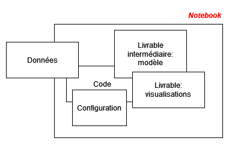
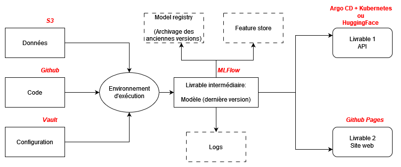

# Introduction

Structuring a project immediately helps identify both the code elements and ancillary parts, such as dependencies to manage, documentation, etc. High-quality scripts alone are not enough to ensure the overall quality of a _data science_ project.

A clear and methodical organization of code and data makes the project easier to understand and facilitates updating and evolving the code. It’s much easier to improve a production pipeline when its components are clearly and distinctly separated rather than all mixed together.

::: {layout-ncol=2}


:::

As in the previous chapter, the goal of a good project structure is to enhance both the __readability__ and __maintainability__ of the code. Also like before, the organization of a project combines formal rules driven by the language (e.g., how the language handles interdependence between scripts) with arbitrary conventions that may evolve over time.

The goal is to remain pragmatic in how we structure the project, adapting it to its intended purpose. Depending on whether the final deliverable is an API or a web app, the technical solution we implement will require different script structures. However, some universal principles can still apply, and we should allow ourselves flexibility if the project's _outputs_ change over time.

The first and non-negotiable step is to use `Git` ([see dedicated chapter](/chapters/application.qmd)). With `Git`, bad practices that could hinder the project’s future development become very obvious and can be fixed early on.

The key principles are as follows:

1. Favor scripts over notebooks — a specific concern for _data science_ projects
2. Organize your project modularly
3. Adopt community standards for project structure
4. (Self)-document your project

These principles are a direct continuation of those covered in the previous chapter.

## Demonstration by Example

Here’s an example of a project structure that might bring back memories:

```
├── report.qmd
├── correlation.png
├── data.csv
├── data2.csv
├── fig1.png
├── figure 2 (copy).png
├── report.pdf
├── partial data.csv
├── script.R
└── script_final.py
```
_Source : [eliocamp.github.io](https://eliocamp.github.io/reproducibility-with-r/materials/day1/02-projects/)_

The following project structure makes it difficult to understand the project. Some key questions arise:

- What are the input data to the pipeline?
- In what order are the intermediate data generated?
- What is the purpose of the graphical outputs?
- Are all the scripts actually used in this project?

By structuring the folder using simple rules — for example, organizing it into _inputs_ and _outputs_ folders — we can significantly improve the project's readability.

```
├── README.md
├── .gitignore
├── data
│   ├── raw
│   │   ├── data.csv
│   │   └── data2.csv
│   └── derived
│       └── partial data.csv
├── src
│   ├── script.py
│   ├── script_final.py
│   └── report.qmd
└── output
    ├── fig1.png
    ├── figure 2 (copy).png
    ├── figure10.png
    ├── correlation.png
    └── report.pdf
```

::: {.callout-note}

Since `Git` is a prerequisite, every project includes a `.gitignore` file (this is especially important when working with data that must not end up on `Github` or `Gitlab`).

A project also includes a `README.md` file at the root — we will come back to this later.

A project using continuous integration will also include specific files:

- if you're using `Gitlab`, the instructions are stored in the `gitlab-ci.yml` file;
- if you're using `Github`, this happens in the `.github/workflows` directory.

:::

By simply changing the file names, the project structure becomes much more readable:

```
├── README.md
├── .gitignore
├── data
│   ├── raw
│   │   ├── dpe_logement_202103.csv
│   │   └── dpe_logement_202003.csv
│   └── derived
│       └── dpe_logement_merged_preprocessed.csv
├── src
│   ├── preprocessing.py
│   ├── generate_plots.py
│   └── report.qmd
└── output
    ├── histogram_energy_diagnostic.png
    ├── barplot_consumption_pcs.png
    ├── correlation_matrix.png
    └── report.pdf
```

Now, the type of input data to the pipeline is clear, and the relationship between scripts, intermediate data, and outputs is transparent.

# 1️⃣ Notebooks Show Their Limits for Production

Jupyter notebooks are very useful for tinkering, experimenting, and communicating. They are thus a good entry point at the beginning of a project (for experimentation) and at the end (for communication).

However, they come with a number of long-term drawbacks that can make the code written in a notebook difficult—or even impossible—to maintain. Here are a few examples:

- All objects (functions, classes, and data) are defined and available in the same file. Any change to a function requires finding its location in the code, editing, and rerunning one or more cells.
- When experimenting, we write code in cells. In a notebook, there is no "margin" to jot down code like in a physical notebook. So we create new cells, not necessarily in order. When rerunning the notebook, this can cause hard-to-debug errors (since the logical execution order is not obvious).
- Notebooks encourage copy-pasting of cells and tweaking code rather than defining reusable functions.
- It is nearly impossible to version control notebooks effectively with Git. Since notebooks are large JSON files behind the scenes, they look more like data than source code. Git cannot easily identify which code blocks have changed.
- Moving notebooks into production is cumbersome, whereas well-written scripts are much easier to productionize (see next parts of the course).
- Jupyter lacks extensions that enforce good practices (linters, etc.), whereas VSCode is perfectly suited.
- Risk of leaking sensitive data, since notebook outputs (e.g., `head` commands) are written to disk by default.

In summary, their main drawbacks are:

- Limited **reproducibility**
- Not suited for **automation**
- Poor **version control**

These issues are particularly tied to the challenges of _data science_:

* The early stages of a data science project are exploratory, and notebooks provide a great interface for this. However, stability becomes more important in later phases.
* Data processing code is often developed non-linearly: you load data, transform it, produce outputs (e.g., summary tables), then go back to modify sources or join with other datasets. Although this exploratory phase is nonlinear, making the pipeline linear and reproducible later requires significant discipline.

The recommendations in this course aim to make long-term maintenance of data science projects as lightweight as possible by promoting code that can be reused by others (or yourself in the future). The best practice is to use self-contained `Python` scripts (with respect to dependencies) encapsulated within a more or less formal processing pipeline. Depending on the project and infrastructure, this might be a single `Python` script or a formal pipeline. The level of formalism should be adjusted depending on available time.

# 2️⃣ Fostering a Modular Structure

In the previous chapter, we recommended using functions. Grouping several functions into a file is called a **module**.

Modularity is a fundamental programming principle that involves dividing a program into several independent modules or scripts, each with a specific purpose. As previously mentioned, structuring a project into modules makes the code more **readable**, **maintainable**, and **reusable**. `Python` provides a flexible and powerful import system, which allows control over variable scope, name conflicts, and dependencies between modules[^1].

[^1]: In this regard, `Python` is much more reliable than `R`. In `R`, if two scripts use functions with the same name but from different packages, there will be a conflict. In `Python`, each module is imported as its own _package_.

## Separating Code, Data, and Execution Environment Storage

Separating the storage of **code**, **data**, and the **execution environment** is important for several reasons:

1. **Data Security**  
   By separating data from code, it's harder to accidentally access sensitive information.
2. **Consistency and Portability**  
   An isolated environment ensures that the code runs reproducibly, regardless of the host machine.
3. **Modularity and Flexibility**  
   You can adapt or update components (code, data, environment) independently.

The next chapter will focus on dependency management. It will show how to link the environment and code to improve project portability.

## Sensitive Configurations: Secrets and Tokens

Running code may depend on personal parameters (authentication tokens, passwords...). **They should never appear in shared source code.**

✅ Best practice: store these configurations in a **separate file**, not versioned (`.gitignore`), in `YAML` format — more readable than `JSON`.

### Example `secrets.yaml`

````yaml
token:
    api_insee: "toto"
    api_github: "tokengh"
pwd:
    base_pg: "monmotdepasse"
````

### Reading in Python

```python
import yaml

with open('secrets.yaml') as f:
    secrets = yaml.safe_load(f)

# using the secret
jeton_insee = secrets['token']['api_insee']
```

This mechanism turns the file into a **Python dictionary** that is easy to navigate.

::: {.callout-note collapse="true"}

## Tests unitaires

Les tests unitaires sont des tests automatisés qui vérifient le bon fonctionnement d'une unité de code, comme une fonction ou une méthode. L'objectif est de s'assurer que chaque unité de code fonctionne correctement avant d'être intégrée dans le reste du programme.

Les tests unitaires sont utiles lorsqu'on travaille sur un code de taille conséquente ou lorsqu'on partage son code à d'autres personnes, car ils permettent de s'assurer que les modifications apportées ne créent pas de nouvelles erreurs.

En `Python`, on peut utiliser le package `unittest` pour écrire des tests unitaires. Voici un exemple tiré de ce [site](https://gayerie.dev/docs/python/python3/unittest.html) :

```python
# fichier test_str.py
import unittest

class ChaineDeCaractereTest(unittest.TestCase):

    def test_reversed(self):
        resultat = reversed("abcd")
        self.assertEqual("dcba", "".join(resultat))

    def test_sorted(self):
        resultat = sorted("dbca")
        self.assertEqual(['a', 'b', 'c', 'd'], resultat)

    def test_upper(self):
        resultat = "hello".upper()
        self.assertEqual("HELLO", resultat)

    def test_erreur

if __name__ == '__main__':
    unittest.main()
```

Pour vérifier que les tests fonctionnent, on exécute ce script depuis la ligne de commande :

```python
python3 test_str.py
.
----------------------------------------------------------------------
Ran 1 test in 0.000s

OK
```

Si on écrit des tests unitaires, il est important de les maintenir ! Prendre du temps pour écrire des tests unitaires qui ne sont pas maintenus et donc ne renvoient plus de diagnostics pertinents est du temps perdu.

:::

## Transformer son projet en _package_ `Python`

Le _package_ est la structure aboutie d'un projet `Python` autosuffisant. Il s'agit d'une manière formelle de contrôler la reproductibilité d'un projet car :

- le _package_ assure une gestion cohérente des dépendances
- le _package_ offre une certaine structure pour la documentation
- le _package_ facilite la réutilisation du code
- le _package_ permet des économies d'échelle, car on peut réutiliser l'un des packages pour un autre projet
- le _package_ facilite le debuggage car il est plus facile d'identifier une erreur quand elle est dans un package
- ...

En `Python`, le _package_ est une structure peu contraignante si on a adopté les bonnes pratiques de structuration de projet. À partir de la structure modulaire précédemment évoquée, il n'y a qu'un pas vers le package : l'ajout d'un fichier `pyproject.toml` qui contrôle la construction du _package_ ([voir ici](https://py-pkgs.org/03-how-to-package-a-python)).

Il existe plusieurs outils pour installer un package dans le système à partir d'une structure de fichiers locale. Les deux principaux sont :

- [`setuptools`](https://pypi.org/project/setuptools/)
- [`poetry`](https://python-poetry.org/)

Le package fait la transition entre un code modulaire et un code portable, concept sur lequel nous reviendrons dans le prochain chapitre.

# 3️⃣ Adopt Community Standards

## _Cookiecutters_

In `Python`, there are standardized project structure templates: called [`cookiecutters`](https://cookiecutter.readthedocs.io/en/stable/). These are community-maintained templates for project directory trees (`.py` files as well as documentation, config, etc.) that can be used as a starting point.

The idea behind [`cookiecutter`](https://cookiecutter.readthedocs.io/en/stable/) is to offer ready-to-use templates to **initialize** a project with a scalable structure. We'll follow the structure proposed by the [_cookiecutter data science_](https://drivendata.github.io/cookiecutter-data-science/) community template.  
The syntax to use is:

```bash
$ pip install cookiecutter
$ cookiecutter https://github.com/drivendata/cookiecutter-data-science
```

The template is customizable, particularly for integrating with remote storage systems. The generated directory tree is large enough to support diverse project types — you typically won't need every single component included by default.

<details>
<summary>Full structure generated by the cookiecutter data science template</summary>

*(Identique au bloc ci-dessus – déjà internationalisé)*

</details>

::: {.callout-note collapse="true"}

## Unit Tests

Unit tests are automated tests that verify the proper functioning of a unit of code, such as a function or a method. The goal is to ensure that each unit of code works correctly before being integrated into the rest of the program.

Unit tests are helpful when working with large codebases or when sharing code with others, because they ensure that modifications don't introduce new bugs.

In `Python`, the `unittest` package can be used to write unit tests. Here's an example from [this site](https://gayerie.dev/docs/python/python3/unittest.html):

```python
# file test_str.py
import unittest

class StringTest(unittest.TestCase):

    def test_reversed(self):
        result = reversed("abcd")
        self.assertEqual("dcba", "".join(result))

    def test_sorted(self):
        result = sorted("dbca")
        self.assertEqual(['a', 'b', 'c', 'd'], result)

    def test_upper(self):
        result = "hello".upper()
        self.assertEqual("HELLO", result)

    def test_erreur

if __name__ == '__main__':
    unittest.main()
```

To verify that the tests work, run this script from the command line:

```python
python3 test_str.py
.
----------------------------------------------------------------------
Ran 1 test in 0.000s

OK
```

If you write unit tests, it’s important to maintain them! Spending time writing unit tests that are no longer maintained and no longer provide useful diagnostics is time wasted.

:::

## Turning Your Project Into a `Python` _Package_

A _package_ is the finalized structure of a self-contained `Python` project. It provides a formal way to ensure the reproducibility of a project because:

- the _package_ handles dependencies consistently
- the _package_ offers built-in documentation structure
- the _package_ facilitates code reuse
- the _package_ enables scalability—you can reuse a package across projects
- the _package_ simplifies debugging since it's easier to pinpoint errors in a package
- ...

In `Python`, packages are relatively easy to set up if you follow good project structuring practices. From the previously discussed modular structure, it’s a short step to a package: simply add a `pyproject.toml` file to control how the _package_ is built ([see here](https://py-pkgs.org/03-how-to-package-a-python)).

There are several tools for installing a package locally from a file structure. The two most common are:

- [`setuptools`](https://pypi.org/project/setuptools/)
- [`poetry`](https://python-poetry.org/)

The package bridges the gap between modular and portable code, a topic we’ll revisit in the next chapter.

# 4️⃣ Documenting Your Project

The first principle, illustrated in the example, is to favor __self-documentation__ through meaningful names for folders and files.

The `README.md` file, located at the root of the project, serves as both the identity card and showcase of the project. On platforms like `GitHub` and `GitLab`, this file is shown by default on the homepage, making it the first impression—a very brief moment that can be crucial for how the project's value is perceived.

Ideally, the `README.md` includes:

- A description of the context and objectives of the project
- An explanation of how it works
- A contribution guide if the project welcomes input as part of an *open-source* initiative

::: {.callout-note}

A few examples of complete `README.md` files in `R`:

- [utilitR](https://github.com/InseeFrLab/utilitR/blob/master/README.md)
- [DoReMIFaSol](https://github.com/InseeFrLab/DoReMIFaSol)

:::
