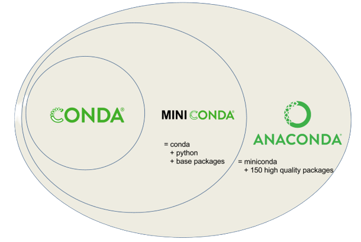

<details>
<summary>
Dérouler les _slides_ ci-dessous ou [cliquer ici](https://ensae-reproductibilite.github.io/slides/#/portabilité)
pour afficher les slides en plein écran.
</summary>


<div class="sourceCode" id="cb1"><pre class="sourceCode yaml code-with-copy"><code class="sourceCode yaml"></code><button title="Copy to Clipboard" class="code-copy-button"><i class="bi"></i></button></pre><iframe class="sourceCode yaml code-with-copy" src="https://ensae-reproductibilite.github.io/slides/#/portabilité"></iframe></div>

</details>

:::: {.content-visible when-profile="fr"}

# Introduction : la notion de portabilité

{fig-align="center"}

Dans les chapitres précédents, nous avons vu un ensemble de bonnes pratiques qui permettent de considérablement améliorer la qualité d'un projet : rendre le code plus lisible, adopter une structure du projet normalisée et évolutive et versionner proprement son code sur un dépôt `GitHub` .

Une fois ces bonnes pratiques appliquées à notre projet, ce dernier apparaît largement partageable. Du moins en théorie, car la pratique est souvent plus compliquée : il y a fort à parier que si vous essayez d'exécuter votre projet sur un autre environnement d'exécution (un autre ordinateur, un serveur, etc.), les choses ne se passent pas du tout comme attendu. Cela signifie que qu'**en l'état, le projet n'est pas [portable]{.colorized} : il n'est pas possible, sans modifications coûteuses, de l'exécuter dans un environnement différent de celui dans lequel il a été développé**.

La raison principale est qu'un code ne vit pas dans une bulle isolée, il contient en général de nombreuses adhérences, plus ou moins visibles, au langage et à l'environnement dans lesquels il a été développé :

- des __dépendances `Python`__ propres au langage du projet. C'est l'environnement des _packages_ nécessaires à exécuter le code ;
- des __dépendances dans d'autres langages__ nécessaires au fonctionnement de certaines librairies `Python`. En effet, `Python` est un langage de haut niveau et certains _packages_ nécessitent des librairies bas-niveau pour être efficaces. Par exemple, `NumPy` est écrit en `C` et nécessite donc un compilateur `C` et `Pytorch` a quant à lui besoin de `C++` ;
- des __dépendances à des librairies systèmes__ nécessaires pour installer certains _packages_
qui ne seront pas les mêmes selon le système d'exploitation utilisé et certains paramètres matériels (par exemple, selon que Windows utilise une version 32 ou 64 bits). Par exemple, les librairies
de manipulation ou de visualisation de données spatiales (`GeoPandas`, `Folium`) reposent sur des librairies systèmes `GDAL` qui sont propres à chaque système d'exploitation[^wheels].

[^wheels]: Nous reviendrons plus tard sur la manière dont la mise à disposition de _packages_ sous forme précompilée par le biais de _wheels_ offre une solution à ce problème.

Le premier problème peut être géré relativement facilement en adoptant une structure de projet ([chapitre précédent](/chapters/projects-architecture.qmd)) avec un fichier
`requirements.txt` bien structuré et versionné.
Les deux autres nécessitent en général des outils plus avancés.

Nous allons progresser dans la démarche de reproductibilité en visant un projet
portable, c'est-à-dire qui peut être
exécuté dans un environnement différent de celui dans lequel il a été développé.
Nous allons avoir besoin de nouveaux outils qui
seront, chacun, des avancées sur l'échelle de la
reproductibilité:

* Les [environnements virtuels](#virtualenv) ;
* Les [conteneurs](#conteneurs).

Ces outils vont nous permettre de **normaliser l'environnement afin de produire un projet portable**. Cette étape est primordiale lorsque l'on se préoccupe de la mise en production d'un projet, car elle assure une transition relativement indolore entre l'environnement de développement et celui de production.

](https://img.devrant.com/devrant/rant/r_174386_yx6zV.jpg){fig-align="center"}

Le choix de la méthode à privilégier dépend d'un arbitrage temps-opportunité. Tous les projets
n'ont pas vocation à être mis à disposition par
le biais de conteneurs. Néanmoins,
l'intérêt d'adopter une démarche de bonnes
pratiques est que si le projet gagne en ambition
et que la conteneurisation s'avère adéquate, celle-ci
sera peu coûteuse à mettre en oeuvre.

# Les environnements virtuels  {#virtualenv}

## Introduction

Pour illustrer l'importance de travailler avec des environnements virtuels, mettons-nous à la place d'un.e aspirant.e *data scientist* qui commencerait ses premiers projets.

Selon toute vraisemblance, on va commencer par installer une distribution de `Python` — souvent, via `Anaconda` — sur son poste et commencer à développer, projet après projet. S'il est nécessaire d'installer une librairie supplémentaire, on le fera sans trop se poser de question. Puis, on passera au projet suivant en adoptant la même démarche. Et ainsi de suite.

Cette démarche naturelle présentera l'avantage de permettre d'aller vite dans les expérimentations.
Néanmoins, elle deviendra problématique s'il devient
nécessaire de partager son projet, ou de reprendre celui-ci dans le futur.

Dans cette approche, les différents *packages* qu'on va être amené à utiliser vont être installés au même endroit. Ceci peut apparaître secondaire, après tout nous utilisons `Python` pour sa simplicité d'usage qui ne nécessite pas de passer des heures à se poser des questions avant d'écrire la moindre ligne de code, mais cela va finir par nous poser plusieurs problèmes :

- **conflits de version** : une application A peut dépendre de la version 1 d'un package là où une application B peut dépendre de la version 2 de ce même package. Ces versions d'un même package peuvent avoir des incompatibilités[^release]. Une seule application peut donc fonctionner dans cette configuration ;
- **version de `Python` fixe** — on ne peut avoir qu'une seule installation par système — là où on voudrait pouvoir avoir des versions différentes selon le projet ;
- **reproductiblité limitée** : difficile de dire quel projet repose sur tel package, dans la mesure où ceux-ci s'accumulent en un même endroit au fil des projets ;
- **portabilité limitée** : conséquence du point précédent, il est difficile de fixer dans un fichier les dépendances spécifiques à un projet, et exclusivement celles-ci.

Les environnements virtuels constituent une solution à ces différents problèmes.

[^release]: S'il est impossible de suivre les évolutions de tous les _packages_ de la _data science_,
il est recommandé de faire une veille sur les principaux comme `Pandas` ou `Scikit` en suivant
les _release notes_ des versions majeures qui introduisent
généralement des non-compatibilités.

## Fonctionnement

Le concept d'environnement virtuel est techniquement très simple.
On peut lui donner la définition suivante pour `Python` :

> _"dossier auto-suffisant qui contient une installation de `Python`
pour une version particulière de `Python` ainsi que des *packages* additionnels
et qui est isolé des autres environnements existants."_

On peut donc simplement voir les environnements virtuels comme un moyen de faire cohabiter sur un même système différentes installations de `Python` avec chacune leur propre liste de packages installés et leurs versions. Développer dans des environnements virtuels vierges à chaque début de projet est une très bonne pratique pour accroître la reproductibilité des analyses.

## Implémentations

Il existe différentes implémentations des environnements virtuels en `Python`, dont chacune ont leurs spécificités et leur communauté d'utilisateurs :

* L'implémentation standard en `Python` est `venv`.
* `conda` propose une implémentation plus complète.

En pratique pour les utilisateurs, ces implémentations sont relativement proches. La différence conceptuelle majeure est que `conda` est à la fois un *package manager* (comme `pip`) et un gestionnaire d'environnements virtuels (comme `venv`).

Pendant longtemps, `conda` en tant que *package manager* s'est avéré très pratique en *data science*, dans la mesure où il gérait non seulement les dépendances `Python` mais aussi dans d'autres langages, comme des dépendances `C`, très utilisées
par les principales librairies de _data science_ et dont l'installation peut être complexe sur certains systèmes d'exploitation. Néanmoins, depuis quelques années, l'installation de _packages_ par `pip` se fait de plus en plus par le biais de [_wheels_](https://pythonwheels.com/) qui sont des versions pré-compilées des librairies systèmes, propres à chaque configuration système.

::: {.callout-note collapse="true"}
## Une différence conceptuelle entre `pip` et `conda`

L'autre différence majeure avec `pip` est que `Conda` utilise une méthode plus avancée — et donc également plus coûteuse en temps — de résolution des dépendances.

En effet, différents packages peuvent spécifier différentes versions d'un même package dont ils dépendent tous les deux, ce qui provoque un conflit de version. `Conda` va par défaut appliquer un algorithme qui vise à gérer au mieux ces conflits, là où `pip` va choisir une approche plus minimaliste[^2].
:::

[^2]: Le _solver_ de `conda`, qui est un algorithme de recherche de chemin optimal dans des graphes pour gérer
les (in)compatibilités de versions, est
lourd à mettre en oeuvre. Le projet [`mamba`](https://mamba.readthedocs.io/en/latest/) a permis d'offrir
une réimplémentation de `Conda` en `C++` par le biais d'un _solver_ plus efficace. Cela a permis de franchement accélérer la vitesse d'installation des _packages_ par le biais de `conda`. Néanmoins,
l'accès de plus en plus fréquent à des [_wheels_](https://pythonwheels.com/) a permis un retour en grâce des environnements virtuels implémentés par `venv` au cours des dernières années.

`pip+venv` présente l'avantage de la simplicité, `conda` de la fiabilité. Selon les projets, on
privilégiera l'un ou l'autre. Néanmoins, si
le projet est amené à fonctionner de manière isolée
dans un conteneur, `venv` suffira amplement car
l'isolation sera fournie par le conteneur comme
nous le verrons ultérieurement.

::: {.callout-note collapse="true"}
## C'est différent en  ?

On lit souvent, notamment chez les _afficionados_ de  que la gestion des environnements en `Python` est chaotique. C'était vrai au début des années 2010 mais c'est quelques peu exagéré aujourd'hui.

La qualité supérieure des outils  pour la gestion des dépendances ne saute pas aux yeux: [`renv`](https://rstudio.github.io/renv/articles/renv.html) est très intéressant mais [ne permet pas de définir la version de
](https://rstudio.github.io/renv/articles/renv.html#caveats) :

> R version: renv tracks, but doesn’t help with, the version of R used with the packge. renv can’t easily help with this because it’s run inside of R, but you might find tools like rig helpful, as they make it easier to switch between multiple version of R on one computer.

C'est, en fait, le problème principal des outils  pour la reproductibilité. Pour les utiliser, il faut souvent se trouver dans une session , avec ses spécificités. Les outils  qui s'utilisent pas le biais de la ligne de commande offrent une robustesse plus importante. `venv` est certes dépendant de la version de  utilisée lors de la création de l'environnement mais le fait de passer par le terminal permet de choisir la version de  qui servira à créer l'environnement. Quant à `conda`, la version de  est définie dans le `environment.yml` ce qui donne une grande liberté.
:::

Puisqu'il n'y a pas de raison absolue d'imposer `pip+venv` ou `conda`, nous recommandons le pragmatisme. Personnellement, nous utilisons plutôt `venv` car nous travaillons principalement dans des microservices basés sur des conteneurs et non sur des postes personnels, ce qui est l'approche moderne dans le monde de la _data science_. Nous présentons néanmoins les deux approches par la suite. L'[application fil rouge](/chapters/application.qmd) propose les deux approches, à vous de choisir celle que vous désirez privilégier.

## Guide pratique d'utilisation d'un environnement virtuel

## Guide pratique d'utilisation d'un environnement virtuel


### Installation

::: {.panel-tabset group="language"}

## `venv`

`venv` est un module inclus par défaut dans `Python`, ce qui le rend facilement accessible pour la gestion d'environnements virtuels.

Les instructions pour utiliser `venv`, l'outil de création d'environnements virtuels intégré à Python, sont détaillées dans la [documentation officielle de Python](https://docs.python.org/fr/3/library/venv.html).

)](https://www.dataquest.io/wp-content/uploads/2022/01/python-virtual-envs1-1024x576.webp)

## `conda`

Les instructions à suivre pour installer `conda` sont détaillées dans la [documentation officielle](https://docs.conda.io/projects/conda/en/latest/user-guide/install/index.html). `conda` seul étant peu utile en pratique, il est généralement installé dans le cadre de distributions. Les deux plus populaires sont :

- `Miniconda` : une distribution minimaliste contenant `conda`, `Python` ainsi qu'un petit nombre de packages techniques très utiles ;
- `Anaconda` : une distribution assez volumineuse contenant `conda`, `Python`, d'autres logiciels (`R`, `Spyder`, etc.) ainsi qu'un ensemble de packages utiles pour la *data science* (`SciPy`, `NumPy`, etc.).



Le choix de la distribution importe assez peu en pratique, dans la mesure où nous allons de toute manière utiliser des environnements virtuels vierges pour développer nos projets.

:::

### Créer un environnement

::: {.panel-tabset group="language"}

## `venv`

Pour commencer à utiliser `venv`, commençons par créer un environnement vierge, nommé `dev`. Pour créer
un environnement virtuel, cela se fait en ligne de commande par le biais de
`Python`. Cela signifie que la version de `Python` utilisée
par cet environnement sera celle utilisée lors de la création de celui-ci.

```{.bash filename="terminal"}
python -m venv dev #<1>
```
1. Sur un système `Windows`, ce sera `python.exe -m venv dev`

Cette commande crée un dossier nommé `dev/` contenant une installation Python isolée.

<details>
<summary>
Exemple sur un système `Linux`
</summary>

</details>

Celle-ci est de la version de `Python` enregistrée par défaut dans le `PATH`, en l'occurrence
`Python 3.11`. Pour créer un environnement virtuel avec une autre version de `Python`, il faudra
définir le chemin de manière formelle, par exemple:

```{.bash filename="terminal"}
/chemin_local/python3.8 -m venv dev-old #<1>
```


## `conda`


Pour commencer à utiliser `conda`, commençons par créer un environnement vierge, nommé `dev`, en spécifiant la version de Python que l'on souhaite installer pour notre projet.

```{.bash filename="terminal"}
conda create -n dev python=3.9.7
```

```{.python}
Retrieving notices: ...working... done
Channels:
 - conda-forge
Platform: linux-64
Collecting package metadata (repodata.json): done
Solving environment: done

## Package Plan ##

  environment location: /opt/mamba/envs/dev

  added / updated specs:
    - python=3.9.7


The following packages will be downloaded:
...
The following NEW packages will be INSTALLED:
...
Proceed ([y]/n)? y
Downloading and Extracting Packages
...
```


Comme indiqué dans les _logs_,
`Conda` a créé notre environnement et nous indique son emplacement sur le *filesystem*.
En réalité, l'environnement n'est jamais vraiment vierge :
`Conda` nous demande — et il faut répondre oui en tapant `y` —
d'installer un certain nombre de packages,
qui sont ceux qui viennent avec la distribution `Miniconda`.

On peut vérifier que l'environnement a bien été créé en listant les environnements installés sur le système.

```{.bash filename="terminal"}
conda info --envs
```

```{.python}
# conda environments:
#
base                  *  /opt/mamba
dev                      /opt/mamba/envs/dev
```

:::

### Activer un environnement

### Activer un environnement

Comme plusieurs environnements peuvent coexister sur un même système,
il faut dire à notre gestionnaire d'environnement d'activer celui-ci.
Dès lors, ce sera celui-ci qui sera utilisé implicitement lorsqu'on
utilisera `python`, `pip`, etc. dans
la ligne de commande active[^sourceactivate].

[^sourceactivate]: Cela signifie que si on ouvre un nouveau terminal, il faudra à nouveau activer cet environnement si on désire l'utiliser. Si on désire activer par défaut un environnement,
il est possible de configurer le terminal pour qu'il active automatiquement un environnement spécifique lors de son ouverture. Cela peut être réalisé en modifiant les fichiers de configuration du shell, par le biais par exemple du script `.bashrc` sur `Linux`.

::: {.panel-tabset group="language"}

## `venv`

```{.bash filename="terminal"}
source dev/bin/activate
```

`venv` active l'environnement virtuel `dev`, indiqué par le changement du nom de l'environnement qui apparaît au début de la ligne de commande dans le terminal. Une fois activé, `dev` devient temporairement notre environnement par défaut pour les opérations `Python`. Pour confirmer cela, nous pouvons utiliser la commande `which` pour déterminer l'emplacement de l'interpréteur Python qui sera utilisé pour exécuter des scripts comme `python mon-script.py`.

```{.bash filename="terminal" env=dev}
which python
```

```{.python}
/home/onyxia/work/dev/bin/python
```

## `conda`

```{.bash filename="terminal"}
conda activate dev
```

`Conda` nous indique que l'on travaille à partir de maintenant dans l'environnement `dev` en indiquant son nom entre parenthèses au début de la ligne de commandes. Autrement dit, `dev` devient pour un temps notre
environnement par défaut.
Pour s'en assurer,
vérifions avec la commande `which` l'emplacement de l'interpréteur Python qui sera utilisé si on lance une commande du type `python mon-script.py`.

```{.bash filename="terminal" env=dev}
which python
```

```{.python}
/opt/mamba/envs/dev/bin/python
```

:::


On travaille bien dans l'environnement attendu : l'interpréteur qui se lance n'est pas celui du système global, mais bien celui spécifique à notre environnement virtuel.

### Lister les packages installés

Une fois l'environnement activé, on peut lister les packages installés et leur version.
Cela confirme qu'un certain nombre de packages sont installés par défaut lors de la création d'un environnement virtuel.

::: {.panel-tabset group="language"}

## `venv`

On part d'un environnement vraiment réduit à l'os:

```{.bash filename="terminal" env=dev}
pip list
```

```{.python}
Package    Version
---------- -------
pip        23.3.2
setuptools 69.0.3
wheel      0.42.0
```


## `conda`

L'environnement est assez minimaliste, quoique plus garni que lors
de la création d'un environnement virtuel par `venv`

```{.bash filename="terminal" env="dev"}
conda list
```

```{.python}
# packages in environment at /opt/mamba/envs/dev:
#
# Name                    Version                   Build  Channel
_libgcc_mutex             0.1                 conda_forge    conda-forge
_openmp_mutex             4.5                       2_gnu    conda-forge
ca-certificates           2023.11.17           hbcca054_0    conda-forge
...
```

:::

Pour se convaincre, on peut vérifier que `Numpy`
est bien absent de notre environnement:

```{.bash filename="terminal" env="dev"}
python -c "import numpy as np"
```

```{.python}
Traceback (most recent call last):
  File "<string>", line 1, in <module>
ModuleNotFoundError: No module named 'numpy'
```

### Installer un package

Notre environnement peut être enrichi, lorsque nécessaire,
avec l'installation d'un _package_ par le biais de la ligne
de commande. La procédure
est très similaire entre `pip` (pour les environnements `venv`) et `conda`.

::: {.callout-caution collapse="true"}
## Mélanger `pip` et `conda`

Il est techniquement possible d'installer des _packages_ par le biais de `pip`
en étant situé dans un environnement virtuel `conda`[^sspcloud-note].
Ce n'est pas un problème pour de l'expérimentation et ça permet de développer
rapidement.

Néanmoins, dans un environnement
de production c'est une [pratique à éviter](https://conda.io/projects/conda/en/latest/user-guide/tasks/manage-environments.html#using-pip-in-an-environment).

- Soit on initialise un environnement
`conda` autosuffisant avec un `env.yml` (voir plus bas) ;
- Soit on crée un environnement `venv` et on fait exclusivement des `pip install`.
:::

[^sspcloud-note]: D'ailleurs, si vous utilisez `pip` sur le SSPCloud,
c'est ce que vous faites, sans vous en rendre compte.

::: {.panel-tabset group="language"}

## `venv`

```{.bash filename="terminal" env="dev"}
pip install nom_du_package
```

## `conda`

```{.bash filename="terminal" env="dev"}
conda install nom_du_package
```

:::

La différence est que là où `pip install` va installer un package à partir du répertoire [PyPI](https://pypi.org/), `conda install` va chercher le package sur les répertoires maintenus par les développeurs de Conda[^1].

Installons par exemple le package phare de *machine learning* `scikit-learn`.

[^1]: Ces répertoires sont, dans le langage `conda`, les _canaux_.
Le canal par défaut est maintenu par les développeurs d`Anaconda`.
Cependant, pour en assurer la stabilité, ce canal a une forte inertie.
La `conda-forge` a émergé pour offrir plus de flexibilité aux développeurs
de _package_ qui peuvent ainsi mettre à disposition des versions plus
récentes de leurs packages, comme sur  [PyPI](https://pypi.org/).

::: {.panel-tabset group="language"}

## `venv`

```{.bash filename="terminal" env="dev"}
pip install scikit-learn
```

```{.python}
pip install scikit-learn
Collecting scikit-learn
  Obtaining dependency information for scikit-learn from https://files.pythonhosted.org/packages/5b/be/208f17ce87a5e55094b0e8ffd55b06919ab9b56e7e4ce2a64cd9095ec5d2/scikit_learn-1.4.0-1-cp311-cp311-manylinux_2_17_x86_64.manylinux2014_x86_64.whl.metadata
  Downloading scikit_learn-1.4.0-1-cp311-cp311-manylinux_2_17_x86_64.manylinux2014_x86_64.whl.metadata (11 kB)
Collecting numpy<2.0,>=1.19.5 (from scikit-learn)
  Obtaining dependency information for numpy<2.0,>=1.19.5 from https://files.pythonhosted.org/packages/5a/62/007b63f916aca1d27f5fede933fda3315d931
...
```

Les dépendances nécessaires (par exemple `Numpy` sont automatiquement installées).
L'environnement s'enrichit donc:

```{.bash filename="terminal" env="dev"}
pip list
```

```{.python}
Package       Version
------------- -------
joblib        1.3.2
numpy         1.26.3
pip           23.2.1
scikit-learn  1.4.0
scipy         1.12.0
setuptools    65.5.0
threadpoolctl 3.2.0
```


## `conda`


```{.bash filename="terminal" env="dev"}
conda install scikit-learn
```

<details>
<summary>
Voir la sortie
</summary>

```{.python}
Channels:
 - conda-forge
Platform: linux-64
Collecting package metadata (repodata.json): done
Solving environment: done

## Package Plan ##

  environment location: /opt/mamba/envs/dev

  added / updated specs:
    - scikit-learn


The following packages will be downloaded:

    package                    |            build
    ---------------------------|-----------------
    joblib-1.3.2               |     pyhd8ed1ab_0         216 KB  conda-forge
    libblas-3.9.0              |21_linux64_openblas          14 KB  conda-forge
    libcblas-3.9.0             |21_linux64_openblas          14 KB  conda-forge
    libgfortran-ng-13.2.0      |       h69a702a_3          23 KB  conda-forge
    libgfortran5-13.2.0        |       ha4646dd_3         1.4 MB  conda-forge
    liblapack-3.9.0            |21_linux64_openblas          14 KB  conda-forge
    libopenblas-0.3.26         |pthreads_h413a1c8_0         5.3 MB  conda-forge
    libstdcxx-ng-13.2.0        |       h7e041cc_3         3.7 MB  conda-forge
    numpy-1.26.3               |   py39h474f0d3_0         6.6 MB  conda-forge
    python_abi-3.9             |           4_cp39           6 KB  conda-forge
    scikit-learn-1.4.0         |   py39ha22ef79_0         8.7 MB  conda-forge
    scipy-1.12.0               |   py39h474f0d3_2        15.6 MB  conda-forge
    threadpoolctl-3.2.0        |     pyha21a80b_0          20 KB  conda-forge
    ------------------------------------------------------------
                                           Total:        41.6 MB

The following NEW packages will be INSTALLED:

  joblib             conda-forge/noarch::joblib-1.3.2-pyhd8ed1ab_0
  libblas            conda-forge/linux-64::libblas-3.9.0-21_linux64_openblas
  libcblas           conda-forge/linux-64::libcblas-3.9.0-21_linux64_openblas
  libgfortran-ng     conda-forge/linux-64::libgfortran-ng-13.2.0-h69a702a_3
  libgfortran5       conda-forge/linux-64::libgfortran5-13.2.0-ha4646dd_3
  liblapack          conda-forge/linux-64::liblapack-3.9.0-21_linux64_openblas
  libopenblas        conda-forge/linux-64::libopenblas-0.3.26-pthreads_h413a1c8_0
  libstdcxx-ng       conda-forge/linux-64::libstdcxx-ng-13.2.0-h7e041cc_3
  numpy              conda-forge/linux-64::numpy-1.26.3-py39h474f0d3_0
  python_abi         conda-forge/linux-64::python_abi-3.9-4_cp39
  scikit-learn       conda-forge/linux-64::scikit-learn-1.4.0-py39ha22ef79_0
  scipy              conda-forge/linux-64::scipy-1.12.0-py39h474f0d3_2
  threadpoolctl      conda-forge/noarch::threadpoolctl-3.2.0-pyha21a80b_0


Downloading and Extracting Packages:

Preparing transaction: done
Verifying transaction: done
Executing transaction: done
```
</details>

Là encore, `conda` nous demande d'installer d'autres packages, qui sont des dépendances de `scikit-learn`. Par exemple, la librairie de calcul scientifique `NumPy`.


```python
(dev) $ conda list
```

```
# packages in environment at /opt/mamba/envs/dev:
#
# Name                    Version                   Build  Channel
_libgcc_mutex             0.1                 conda_forge    conda-forge
_openmp_mutex             4.5                       2_gnu    conda-forge
ca-certificates           2023.11.17           hbcca054_0    conda-forge
joblib                    1.3.2              pyhd8ed1ab_0    conda-forge
ld_impl_linux-64          2.40                 h41732ed_0    conda-forge
libblas                   3.9.0           21_linux64_openblas    conda-forge
libcblas                  3.9.0           21_linux64_openblas    conda-forge
libffi                    3.4.2                h7f98852_5    conda-forge
libgcc-ng                 13.2.0               h807b86a_3    conda-forge
libgfortran-ng            13.2.0               h69a702a_3    conda-forge
libgfortran5              13.2.0               ha4646dd_3    conda-forge
libgomp                   13.2.0               h807b86a_3    conda-forge
liblapack                 3.9.0           21_linux64_openblas    conda-forge
libopenblas               0.3.26          pthreads_h413a1c8_0    conda-forge
libsqlite                 3.44.2               h2797004_0    conda-forge
libstdcxx-ng              13.2.0               h7e041cc_3    conda-forge
libzlib                   1.2.13               hd590300_5    conda-forge
ncurses                   6.4                  h59595ed_2    conda-forge
numpy                     1.26.3           py39h474f0d3_0    conda-forge
openssl                   3.2.0                hd590300_1    conda-forge
pip                       23.3.2             pyhd8ed1ab_0    conda-forge
python                    3.9.7           hf930737_3_cpython    conda-forge
python_abi                3.9                      4_cp39    conda-forge
readline                  8.2                  h8228510_1    conda-forge
scikit-learn              1.4.0            py39ha22ef79_0    conda-forge
scipy                     1.12.0           py39h474f0d3_2    conda-forge
setuptools                69.0.3             pyhd8ed1ab_0    conda-forge
sqlite                    3.44.2               h2c6b66d_0    conda-forge
threadpoolctl             3.2.0              pyha21a80b_0    conda-forge
tk                        8.6.13          noxft_h4845f30_101    conda-forge
tzdata                    2023d                h0c530f3_0    conda-forge
wheel                     0.42.0             pyhd8ed1ab_0    conda-forge
xz                        5.2.6                h166bdaf_0    conda-forge
zlib                      1.2.13               hd590300_5    conda-forge
```

:::

### Exporter les spécifications de l'environnement

Développer à partir d'un environnement vierge est une bonne pratique de reproductibilité :  
en partant d'une base minimale, on s'assure que seuls les packages effectivement nécessaires  
au bon fonctionnement de notre application ont été installés au fur et à mesure du projet.

Cela rend également notre projet plus aisé à rendre portable.  
On peut exporter les spécifications de l'environnement  
dans un fichier spécial qui peut permettre de créer un nouvel environnement similaire  
à celui ayant servi initialement.

::: {.panel-tabset group="language"}

## `venv`

```{.bash filename="terminal" env="dev"}
pip freeze > requirements.txt
```

<details>
<summary>
Voir le fichier `requirements.txt` généré
</summary>

```{.python filename="requirements.txt"}
joblib==1.3.2
numpy==1.26.3
scikit-learn==1.4.0
scipy==1.12.0
threadpoolctl==3.2.0
```

</details>

## `conda`

```{.bash filename="terminal" env="dev"}
conda env export > environment.yml
```

</details>

:::

Ce fichier est mis par convention à la racine du dépôt `Git` du projet.  
Ainsi, les personnes souhaitant tester l'application peuvent recréer le même environnement Conda que celui qui a servi au développement via la commande suivante.

::: {.panel-tabset group="language"}

## `venv`

On refait la démarche précédente de création d'un  
environnement vierge puis un `pip install -r requirements.txt`

```{.bash filename="terminal"}
python -m venv newenv
source newenv/bin/activate
```

```{.bash filename="terminal" env="newenv"}
pip install -r requirements.txt
```

## `conda`

Cela se fait en une seule commande:

```{.bash filename="terminal"}
conda env create -f environment.yml
```

:::

### Changer d'environnement

::: {.panel-tabset group="language"}

## `venv`

Pour changer d'environnement virtuel, il suffit d'en activer un autre.

```{.bash filename="terminal" no-prefix="true"}
(myenv) $ deactivate
$ source anotherenv/bin/activate
(anotherenv) $ which python
/chemin/vers/anotherenv/bin/python
```

Pour quitter l'environnement virtuel actif, on utilise simplement la commande `deactivate` :

```{.bash filename="terminal" no-prefix="true"}
(anotherenv) $ deactivate
$
```

## `conda`

Pour changer d'environnement, il suffit d'en activer un autre.

```{.bash filename="terminal" no-prefix="true"}
(dev) $ conda activate base
(base) $ which python
/opt/mamba/bin/python
```

Pour sortir de tout environnement conda, on utilise la commande `conda deactivate` :

```{.bash filename="terminal" no-prefix="true"}
(base) $ conda deactivate
$
```

:::

<details>
<summary>
Voir le fichier `environment.yml` généré
</summary>

```{.python filename="environment.yml"}
name: dev
channels:
  - conda-forge
dependencies:
  - _libgcc_mutex=0.1=conda_forge
  - _openmp_mutex=4.5=2_gnu
  - ca-certificates=2023.11.17=hbcca054_0
  - joblib=1.3.2=pyhd8ed1a
```

</details>

### Aide-mémoire

| `venv` | `conda` | Principe |
|--------|---------|----------|
| `python -m venv <env_name>` | `conda create -n <env_name> python=<python_version>` | Création d'un environnement nommé `<env_name>` dont la version de Python est `<python_version>` |
|        | `conda info --envs` | Lister les environnements |
| `source <env_name>/bin/activate` | `conda activate <env_name>` | Utiliser l'environnement `<env_name>` pour la session du terminal |
| `pip list` | `conda list` | Lister les _packages_ dans l'environnement actif |
| `pip install <pkg>` | `conda install <pkg>` | Installer le _package_ `<pkg>` dans l'environnement actif |
| `pip freeze > requirements.txt` | `conda env export > environment.yml` | Exporter les spécifications de l’environnement dans un fichier `requirements.txt` |

## Limites

Développer dans des environnements virtuels est une bonne pratique, car cela accroît la portabilité d'une application. Néanmoins, il y a plusieurs limites à leur utilisation :

- les librairies système nécessaires à l'installation des packages ne sont pas gérées ;
- les environnements virtuels ne permettent pas toujours de gérer des projets faisant intervenir différents langages de programmation ;
- devoir installer `conda`, `Python`, et les packages nécessaires à chaque changement d'environnement peut être assez long et pénible en pratique ;
- dans un environnement de production, gérer des environnements virtuels différents pour chaque projet peut s'avérer rapidement complexe pour les administrateurs système.

La technologie des conteneurs permet de répondre à ces différents problèmes.

# Les conteneurs 🐋


](https://external-preview.redd.it/aR6WdUcsrEgld5xUlglgKX_0sC_NlryCPTXIHk5qdu8.jpg?auto=webp&s=5fe64dd318eec71711d87805d43def2765dd83cd){fig-align="center"}

## Introduction

Avec les environnements virtuels,  
l'idée était de permettre à chaque utilisateur potentiel de notre projet d'installer sur son environnement d'exécution les packages nécessaires à la bonne exécution du projet.

Néanmoins, comme on l'a vu, cette approche ne garantit pas une reproductibilité parfaite et a l'inconvénient de demander beaucoup de gestion manuelle.

Changeons de perspective : _au lieu de distribuer une recette permettant à l'utilisateur de recréer l'environnement nécessaire sur sa machine, ne pourrait-on pas directement distribuer à l'utilisateur une machine contenant l'environnement pré-configuré ?_

Bien entendu, on ve pas configurer et envoyer des ordinateurs portables à tous les utilisateurs potentiels d'un projet.  
On va donc essayer de livrer une version virtuelle  
de notre ordinateur. Il existe deux approches principales pour cela:

- Les __machines virtuelles__. Cette approche n'est pas nouvelle.  Elle consiste à recréer, sur un serveur, un environnement informatique complet (matériel et système d'exploitation) qui réplique le comportement d'un véritable ordinateur.
- Les __conteneurs__, une solution plus légère pour empaqueter un environnement informatique afin de répliquer le comportement d'une machine réelle.

## Fonctionnement

Les machines virtuelles ont l'inconvénient d'être assez lourdes, et complexes à répliquer et distribuer. Pour pallier ces différentes limites, les conteneurs se sont imposés au cours de la dernière décennie. Toutes les infrastructures _cloud_ modernes ont progressivement abandonné les machines virtuelles pour privilégier des conteneurs pour les raisons que nous allons évoquer ultérieurement.

Comme les machines virtuelles, les conteneurs permettent d'empaqueter complètement l'environnement (librairies systèmes, application, configuration) qui permet de faire tourner l'application.  
Mais à l'inverse d'une machine virtuelle, le conteneur n'inclut pas de système d'exploitation propre, il utilise celui de la machine hôte qui l'exécute.  
Cela signifie que si on désire reproduire le comportement d'une machine Windows, il n'est pas nécessaire d'avoir un gros serveur avec Windows. Il est tout à fait possible d'avoir un serveur Linux, ce qui est la norme, et de répliquer le comportement d'une machine Windows à l'intérieur. A l'inverse, cela peut permettre de tester des configurations Linux ou Mac sur un ordinateur Windows. C'est le rôle du logiciel de conteneurisation qui fera la traduction entre les instructions voulues par le _software_ et le système d'exploitation du _hardware_.

La technologie des conteneurs permet ainsi de garantir une très forte reproductibilité tout en restant suffisamment légère pour permettre une distribution et un déploiement simple aux utilisateurs. En effet, l'adhérence forte entre un système d'exploitation et un logiciel dans l'approche des machines virtuelles rend plus complexe la montée en charge d'un serveur. Si plus d'utilisateurs commencent à utiliser l'application, il est nécessaire de s'assurer que des serveurs correspondant aux besoins de l'application (système d'exploitation, configurations techniques, etc.) soient disponibles. Avec les conteneurs, la montée en charge est plus simple puisque les restrictions matérielles sont moins fortes: ajouter un serveur Linux avec les logiciels adéquats peut être suffisant.

)](/docker-vm.png)

Du point de vue de l'utilisateur, la différence n'est pas toujours perceptible pour des besoins standards.  
L'utilisateur accédera à son application par une application dédiée (un navigateur, un logiciel spécialisé...) et les calculs issus des opérations effectuées seront déportés sur les serveurs où est hébergée cette application. Néanmoins, pour l'organisation qui gère cette application, les conteneurs offriront plus de liberté et de flexibilité comme nous l'avons évoqué.

## `Docker` , l'implémentation standard

Comme nous l'avons évoqué, le logiciel de conteneurisation fait office de couche tampon entre les applications et le système d'exploitation du serveur.

Comme pour les environnements virtuels, il existe différentes implémentations de la technologie des conteneurs. En pratique, l'implémentation offerte par `Docker` est devenue largement prédominante, au point qu'il est devenu courant d'utiliser de manière interchangeable les termes _"conteneuriser"_ et _"Dockeriser"_ une application. C'est donc cette implémentation que nous allons étudier et utiliser dans ce cours.

### Installation et environnements bacs à sable

`Docker`  est un logiciel qui peut s'installer sur différents système d'exploitation.  
Les instructions sont détaillées dans la [documentation officielle](https://docs.docker.com/get-docker/).  
Il est nécessaire d'avoir des droits administrateurs sur son poste pour pouvoir faire cette installation.

::: {.callout-warning collapse="true"}
## Besoins en espace disque

Il est également recommandé d'avoir de l'espace disque libre car certaines images (concept sur lequel nous reviendrons), une fois décompressées et construites, peuvent être lourdes selon la richesse des librairies installées dessus. Elles peuvent rapidement prendre quelques Gigas d'espace disque.

Ceci est néanmoins à comparer à l'espace disque monstrueux que peut prendre un système d'exploitation complet (autour de 15GB pour Ubuntu ou Mac OS, 20GB par exemple pour Windows...). La distribution Linux la plus minimaliste ([Alpine](https://hub.docker.com/_/alpine/tags)) ne fait que 3Mo compressée et 5Mo une fois décompressée.
:::

Il existe également des environnements en ligne gratuits pouvant servir de bacs à sable s'il n'est pas possible pour vous d'installer `Docker`.  
_[Play with Docker](https://labs.play-with-docker.com)_ permet de tester en ligne `Docker` comme on pourrait le faire sur une installation personnelle. Néanmoins, ces services sont limités: la taille maximale des images décompressées est limitée à 2Go, les services connaissent des coupures en cas d'utilisation massive...

Comme nous le verrons ultérieurement, l'utilisation de `Docker` en interactif est pratique pour apprendre et expérimenter. Néanmoins, en pratique, on utilise principalement `Docker` par le biais de l'intégration continue via `Github Actions` ou `Gitlab CI`.

### Principes

](https://ensae-reproductibilite.github.io/slides/img/docker-workflow.png)

Un conteneur Docker est mis à disposition sous la forme d'une **image**, c'est à dire d'un fichier binaire qui contient l'environnement nécessaire à l'exécution de l'application. Celui-ci est mis à disposition de tous sous une forme compressée sur un dépôt d'images publiques (le plus connu est `Dockerhub`).

Avant de mettre à disposition une image, il est nécessaire de la construire (*build*).  
Pour cela on utilise un `Dockerfile`, un fichier texte qui contient la recette — sous forme de commandes Linux — de construction de l'environnement.

Une fois l'image construite, il est possible de faire deux actions:

- La lancer (*run*) en local. Cela permet de tester l'application, éventuellement de la corriger en cas de mauvais fonctionnement. Le lancement de l'application permet de faire tourner l'image dans un environnement isolé qu'on appelle le conteneur (*container*), une instance vivante de l'image en quelques sortes[^assimilation].
- La mettre à disposition sur un dépôt public pour permettre à d'autres (ou à soi-même) de la tester.  
L'image va être uploadée (*push*) sur un dépôt (*registry*), public ou privé, depuis lequel les utilisateurs vont pouvoir télécharger l'image (*pull*).

[^assimilation]: Par abus de langage, on mélange souvent les termes _"image"_ et _"conteneur"_. En pratique ces deux concepts sont très proches.  
Le second correspond à la version vivante du premier.

::: {.callout-note collapse="true"}
## Mettre à disposition son image `Docker`

Le répertoire d'images publiques le plus connu est [`DockerHub`](https://hub.docker.com/). Il s'agit d'un répertoire où n'importe qui peut proposer une image `Docker`, associée ou non à un projet disponible sur `Github` ou `Gitlab`. Il est possible de mettre à disposition de manière manuelle des images mais, comme nous le montrerons dans le chapitre sur la [mise en production](/chapters/deployment.html), il est beaucoup plus pratique d'utiliser des fonctionalités d'interaction automatique entre `DockerHub` et un dépôt `GitHub`.
:::

# `Docker` en pratique: un exemple

[L'application fil rouge](/chapters/application.qmd)
présente des exemples similaires sur notre cas d'usage
qu'est une application visant à rendre public les résultats de notre modèle de _machine learning_.

## Application

Afin de présenter l'utilisation de `Docker` en pratique, nous allons présenter les différentes étapes permettant de _"dockeriser"_ une application web minimaliste construite avec le _framework_ `Python` [`Flask`](https://flask.palletsprojects.com/en/2.1.x/)[^3].

[^3]: [`Flask`](https://flask.palletsprojects.com/en/2.1.x/) est un
_framework_ permettant de déployer, de manière légère,
des applications reposant sur
`Python`.

La structure de notre projet est la suivante.

```
├── myflaskapp
│   ├── Dockerfile
│   ├── hello-world.py
│   └── requirements.txt
```


Le script `hello-world.py` contient le code d'une application minimaliste, qui affiche simplement _"Hello, World!"_ sur une page web. Nous verrons
dans l'[application fil rouge](/chapters/application.qmd) comment construire une application interactive plus complète.

```{.python filename="hello-world.py"}
from flask import Flask

app = Flask(__name__)


@app.route("/")
def hello_world():
    return "<p>Hello, World!</p>"
```

Pour faire tourner l'application, il nous faut donc à la fois `Python` et le package `Flask`.
Il est donc nécessaire de contrôler l'environnement virtuel autour de `Python` ce qui va impliquer:

- Installer `Python` ;
- Installer les _packages_ nécessaires à l'exécution de notre code. En l'occurrence, on n'a besoin que de `Flask`.

Si la version de `Python` utilisée par notre application nous importe peu, il est plus simple d'adopter un environnement virtuel `venv` que `conda`. Nous allons donc proposer d'utiliser ceci ce qui tombe bien car nous avons déjà notre `requirements.txt` qui
prend la forme suivante:

```{.python filename="requirements.txt"}
Flask==2.1.1
```

Ces installations en deux temps (`Python` et packages nécessaires)  doivent être spécifiées dans le `Dockerfile` (cf. [section suivante](#dockerfile)).

## Le `Dockerfile` {#dockerfile}

Pour faire un plat, il faut une recette. Pour faire
une image image `Docker`, il faut un `Dockerfile`.

Ce fichier texte contient une série de commandes qui permettent de construire l'image. Ces fichiers peuvent être plus ou moins complexes selon l'application que l'on cherche à conteneuriser, mais leur structure est assez normalisée.

L'idée est de partir d'une couche de base (une distribution Linux minimaliste) et y ajouter des couches en fonction des besoins de notre application.

Pour illustrer cela, analysons ligne à ligne le `Dockerfile` nécessaire pour construire une image `Docker` de notre application `Flask.`

```{.python}
#| filename: Dockerfile

FROM ubuntu:20.04 #<1>

RUN apt-get update -y && \
    apt-get install -y python3-pip python3-dev #<2>

WORKDIR /app #<3>

COPY requirements.txt /app/requirements.txt #<4>
RUN pip install -r requirements.txt #<4>

COPY . /app #<4>

ENV FLASK_APP="hello-world.py" #<5>
EXPOSE 5000 #<6>

CMD ["flask", "run", "--host=0.0.0.0"] #<7>
```
1. `FROM` : spécifie l'image de base. Une image `Docker` hérite toujours d'une image de base. Ici, on choisit l'image `Ubuntu` version `20.04`, tout va donc se passer comme si l'on développait sur une machine virtuelle vierge ayant pour système d'exploitation `Ubuntu 20.04`  ;
2. `RUN` : lance une commande Linux. Ici, on met d'abord à jour la liste des packages téléchargeables via `apt`, puis on installe `Python`  ainsi que des librairies système nécessaires au bon fonctionnement de notre application ;
3. `WORKDIR` : spécifie le répertoire de travail de l'image. Ainsi, toutes les commandes suivantes seront exécutées depuis ce répertoire. C'est l'équivalent `Docker` de la commande `cd` (voir [Linux 101](/chapters/linux101.qmd)) ;
4. `COPY` : copie un fichier local sur l'image `Docker`. Cela est lié à la manière dont fonctionne `Docker`. Pour ne pas polluer l'image de fichiers non nécessaires (qui affecteront de manière incidente sa configuration et le poids de celle-ci), par défaut, votre image ne contient pas de fichiers de votre projet. Si certains sont nécessaires pour construire l'image, il faut explicitement le dire à `Docker`.
Ici, on copie d'abord le fichier `requirements.txt` du projet, qui spécifie les dépendances `Python` de notre application, puis on les installe avec une commande `RUN`. La seconde instruction `COPY` copie le répertoire du projet sur l'image ;
5. `ENV` : crée une variable d'environnement qui sera accessible à l'application dans le conteneur. Ici, on définit une variable d'environnement attendue par `Flask`, qui spécifie le nom du script permettant de lancer l'application ;
6. `EXPOSE` : informe `Docker` que le conteneur "écoute" sur le port 5000, qui est le port par défaut utilisé par le serveur web de `Flask`. Ceci est lié à la nature du fonctionnement de `Flask` qui lance un _localhost_ sur un port donné, en l'occurrence le port 5000. ;
7. `CMD` : spécifie la commande que doit exécuter le conteneur lors de son lancement. Il s'agit d'une liste, qui contient les différentes parties de la commande sous forme de chaînes de caractères. Ici, on lance la commande `flask run` qui sait automatiquement quelle application lancer du fait de la commande `ENV` spécifiée précédemment. On ajoute l'option `--host=0.0.0.0` pour que ce soit l'application déployée sur le _localhost_ (notre application `Flask`) qui soit mis à disposition de l'utilisateur final.

::: {.callout-tip collapse="true"}
## Choisir l'image de base

Dans l'idéal, on essaie de partir d'une couche la plus petite possible
pour limiter la taille de l'image finalement obtenue. Il n'est en effet
pas nécessaire d'utiliser une image disposant de  si on n'utilise que
du .

En général, les différents langages proposent des images de petite taille dans lequel un interpréteur est déjà installé et proprement configuré. Dans cette application, on aurait par exemple pu utiliser l'image [`python:3.9-slim-buster`](https://hub.docker.com/layers/python/library/python/3.9-slim-buster/images/sha256-e07b35c0c81c21995a43cefd64730ac0e57a5164cc440b6a5c94c118cfacd0ca?context=explore).
:::


Avec la première commande `RUN` du `Dockerfile`, nous installons `Python` mais aussi des librairies système nécessaires au bon fonctionnement de l'application. Mais comment les avons-nous trouvées ?

Par essai et erreur. Lors de l'étape de [build](#build) que l'on verra juste après, le moteur `Docker` va essayer de construire l'image selon les spécifications du `Dockerfile`, comme s'il partait d'un ordinateur vide contenant simplement `Ubuntu 20.04`. Si des librairies manquent, le processus de *build* devrait renvoyer une erreur, qui s'affichera dans les *logs* de l'application, affichés par défaut dans la console. Quand on a de la chance, les _logs_ décrivent explicitement les librairies système manquantes. Mais souvent, les messages d'erreur ne sont pas très explicites, et il faut alors les copier dans un moteur de recherche bien connu pour trouver la réponse, souvent sur [StackOverflow](https://stackoverflow.com/).

Il est recommandé, avant d'essayer de créer une image `Docker`, de passer par l'étape intermédiaire dans la démarche de reproductibilité qu'est la création d'un script shell (`.sh`). Cette approche graduelle est illustrée dans [l'application fil rouge](/chapters/application.qmd).


::: {.callout-note collapse="true"}
## L'instruction `COPY`
La recette présente dans le `Dockerfile` peut nécessiter l'utilisation de
fichiers appartenant au dossier de travail. Pour que `Docker` les trouve
dans son contexte, il est nécessaire d'introduire une
commande `COPY`. C'est un petit peu comme pour la cuisine: pour utiliser
un produit dans une recette, il faut le sortir du frigo (fichier local)
et le mettre sur la table.
:::


Nous n'avons ici vu que les commandes `Docker` les plus fréquentes, il en existe beaucoup d'autres en pratique. N'hésitez pas à consulter la [documentation officielle](https://docs.docker.com/engine/reference/builder/) pour comprendre leur utilisation.

## Construction d'une image Docker {#build}

Pour construire une image à partir d'un `Dockerfile`, il suffit d'utiliser la commande `docker build` depuis la ligne de commande[^windows]. Il faut ensuite spécifier deux éléments importants :

- le __*build context*__. Il faut indiquer à `Docker` le chemin de notre projet, qui doit contenir le `Dockerfile`. En pratique, il est plus simple de se mettre dans le dossier du projet via la commande `cd`, puis de passer `.` comme *build context* pour indiquer à `Docker` de *build* "d'ici" ;
- le __*tag*__, c'est-à-dire le nom de l'image. Tant que l'on utilise `Docker` en local, le *tag* importe peu. On verra par la suite que la structure du *tag* a de l'importance lorsque l'on souhaite [exporter](#imp-docker) ou [importer](#exp-docker) une image `Docker` à partir d'un dépôt distant.

[^windows]: Si vous êtes sur Windows, les lignes de commande disponibles par défaut (`cmd` ou `Powershell`) sont peu pratiques. Il est recommandé d'utiliser la ligne de commande de `Git Bash` (une émulation minimaliste d'une ligne de commande `Linux`) qui vous permettra de faire des opérations en ligne de commande.

Regardons ce qui se passe en pratique lorsque l'on essaie de construire notre image. Le tag de celle-ci est `myflaskapp`:

```{.bash filename="terminal"}
docker build -t myflaskapp .
```

```{.python}
Sending build context to Docker daemon     47MB
Step 1/8 : FROM ubuntu:20.04
 ---> 825d55fb6340
Step 2/8 : RUN apt-get update && apt-get install -y python3-pip python3-dev
 ---> Running in 92b42d579cfa
...
done.
Removing intermediate container 92b42d579cfa
 ---> 8826d53e3c01
Step 3/8 : WORKDIR /app
 ---> Running in 153b32893c23
Removing intermediate container 153b32893c23
 ---> 7b4d22021986
Step 4/8 : COPY requirements.txt /app/requirements.txt
...
Successfully built 125bd8da70ff
Successfully tagged myflaskapp:latest
```


Le moteur `Docker` essaie de construire notre image séquentiellement à partir des commandes spécifiées dans le `Dockerfile`. S'il rencontre une erreur, la procédure s'arrête, et il faut alors trouver la source du problème dans les *logs* et adapter le `Dockerfile` en conséquence.

Si tout se passe bien, `Docker` nous indique que le *build* a réussi et l'image est prête à être utilisée. On peut vérifier que l'image est bien disponible à l'aide de la commande `docker images`.

```{.bash filename="terminal"}
docker images
```

```{.python}
REPOSITORY                               TAG       IMAGE ID       CREATED          SIZE
myflaskapp                               latest    57d2f410a631   2 hours ago      433MB
```

Intéressons-nous un peu plus en détail aux *logs* de l'étape de *build* 👆️.

Entre les étapes, `Docker` affiche des suites de lettres et de chiffres un peu ésotériques, et nous parle de conteneurs intermédiaires. En fait, il faut voir une image `Docker` comme un empilement de couches (*layers*), qui sont elles-mêmes des images `Docker`. Quand on hérite d'une image avec l'instruction `FROM`, on spécifie donc à `Docker` la couche initiale, sur laquelle il va construire le reste de notre environnement. À chaque étape sa nouvelle couche, et à chaque couche son *hash*, un identifiant unique fait de lettres et de chiffres.

Cela peut ressembler à des détails techniques, mais c'est en fait extrêmement utile en pratique, car cela permet à `Docker` de faire du *caching*. Lorsqu'on développe un `Dockerfile`, il est fréquent de devoir modifier ce dernier de nombreuses fois avant de trouver la bonne recette, et on aimerait bien ne pas avoir à *rebuild* l'environnement complet à chaque fois. `Docker` gère cela très bien : il *cache* chacune des couches intermédiaires[^cacheCI].

Par exemple, si l'on modifie la 5ème commande du `Dockerfile`, `Docker` va utiliser le cache pour ne pas avoir à recalculer les étapes précédentes, qui n'ont pas changé. Cela s'appelle l'_"invalidation du cache"_ :
dès lors qu'une étape du `Dockerfile` est modifiée, `Docker` va recalculer toutes les étapes suivantes, mais seulement celles-ci. Conséquence directe de cette observation : il faut toujours ordonner les étapes d'un `Dockerfile` de sorte à ce qui est le plus susceptible d'être souvent modifié soit à la fin du fichier, et inversement.

[^cacheCI]: Le _cache_ est très pratique pour une construction expérimentale en local. Malheureusement, lorsqu'on passe par des services d'intégration continue, l'utilisation du _cache_ est moins évidente car chaque `run` se fait sur une machine indépendante de la précédente.

Pour illustrer cela, regardons ce qui se passe si l'on modifie le nom du script qui lance l'application, et donc la valeur de la variable d'environnement `FLASK_APP` dans le `Dockerfile`.

```{.bash filename="terminal"}
docker build . -t myflaskapp
```

```{.python}
Sending build context to Docker daemon  4.096kB
Step 1/10 : FROM ubuntu:20.04
 ---> 825d55fb6340
Step 2/10 : ENV DEBIAN_FRONTEND=noninteractive
 ---> Using cache
 ---> ea1c7c083ac9
Step 3/10 : RUN apt-get update -y &&     apt-get install -y python3-pip python3-dev
 ---> Using cache
 ---> 078b8ac0e1cb
Step 4/10 : WORKDIR /app
 ---> Using cache
 ---> cd19632825b3
Step 5/10 : COPY requirements.txt /app/requirements.txt
 ---> Using cache
 ---> 271cd1686899
Step 6/10 : RUN pip install -r requirements.txt
 ---> Using cache
 ---> 3ea406fdf383
Step 7/10 : COPY . /app
 ---> 3ce5bd3a9572
Step 8/10 : ENV FLASK_APP="new.py"
 ---> Running in b378d16bb605
Removing intermediate container b378d16bb605
 ---> e1f50490287b
Step 9/10 : EXPOSE 5000
 ---> Running in ab53c461d3de
Removing intermediate container ab53c461d3de
 ---> 0b86eca40a80
Step 10/10 : CMD ["flask", "run", "--host=0.0.0.0"]
 ---> Running in 340eec151a51
Removing intermediate container 340eec151a51
 ---> 16d7a5b8db28
Successfully built 16d7a5b8db28
Successfully tagged myflaskapp:latest
```

L'étape de *build* a pris quelques secondes au lieu de plusieurs minutes, et les *logs* montrent bien l'utilisation du cache faite par `Docker` : les étapes précédant le changement réutilisent les couches cachées, mais celle d'après sont recalculées.

## Exécuter (_run_) une image `Docker` {#execution}

L'étape de *build* a permis de créer une *image* `Docker`. Une image doit être vue comme un *template* : elle permet d'exécuter l'application sur n'importe quel environnement d'exécution sur lequel un moteur `Docker` est installé.

En l'état, on a donc juste *construit*, mais rien *lancé* : notre application ne tourne pas encore. Pour cela, il faut créer un *conteneur*, i.e. une instance vivante de l'image qui permet d'accéder à l'application. Cela se fait via la commande `docker run`.

```{.bash filename="terminal" no-prefix=true}
$ docker run -d -p 8000:5000 myflaskapp:latest
6a2ab0d82d051a3829b182ede7b9152f7b692117d63fa013e7dfe6232f1b9e81
```

Détaillons la syntaxe de cette commande :

- `docker run tag` : lance l'image dont on fournit le *tag*. Le *tag* est de la forme `repository/projet:version`. Ici, il n'y a pas de *repository* puisque tout est fait en local ;
- `-d` : "détache" le conteneur du terminal qui le lance ;
- `-p` : effectue un *mapping* entre un port de la machine qui exécute le conteneur, et le conteneur lui-même. Notre conteneur écoute sur le port 5000, et l'on veut que notre application soit exposée sur le port 8000 de notre machine.

Lorsque l'on exécute `docker run`, `Docker` nous répond simplement un *hash* qui identifie le conteneur que l'on a lancé. On peut vérifier qu'il tourne bien avec la commande `docker ps`, qui renvoie toutes les informations associées au conteneur.

```{.bash filename="terminal"}
docker ps
```

```{.python}
CONTAINER ID   IMAGE        COMMAND                  CREATED         STATUS         PORTS                                   NAMES
6a2ab0d82d05   myflaskapp   "flask run --host=0.…"   7 seconds ago   Up 6 seconds   0.0.0.0:8000->5000/tcp, :::8000->5000/tcp   vigorous_kalam
```

Les conteneurs peuvent être utilisés pour réaliser des tâches très différentes. Grossièrement, on peut distinguer deux situations :

- le conteneur effectue une tâche "one-shot", c'est-à-dire une opération qui a vocation à s'effectuer en un certain temps, suite à quoi le conteneur peut s'arrêter ;
- le conteneur exécute une application. Dans ce cas, on souhaite que le conteneur reste en vie aussi longtemps que l'on souhaite utiliser l'application en question.

Dans notre cas d'application, on se situe dans la seconde configuration puisque l'on veut exécuter une application web. Lorsque l'application tourne, elle expose sur le *localhost*, accessible depuis un navigateur web — en l'occurence, à l'adresse [localhost:5000/](localhost:5000/). Les calculs sont effectués sur un serveur local, et le navigateur sert d'interface avec l'utilisateur — comme lorsque vous utilisez un _notebook_ `Jupyter` par exemple.

Finalement, on a pu développer et exécuter une application complète sur notre environnement local, sans avoir eu à installer quoi que ce soit sur notre machine personnelle, à part `Docker.`

## Exporter une image `Docker` {#exp-docker}

Jusqu'à maintenant, toutes les commandes `Docker` que nous avons exécutées se sont passées en local. Ce mode de fonctionnement peut être intéressant pour la phase de développement et d'expérimentation. Mais comme on l'a vu, un des gros avantages de `Docker` est la facilité de redistribution des images construites, qui peuvent ensuite être utilisées par de nombreux utilisateurs pour faire tourner notre application. Pour cela, il nous faut _uploader_ notre image sur un dépôt distant, à partir duquel les utilisateurs pourront la télécharger.

Plusieurs possibilités existent selon le contexte de travail : une entreprise peut avoir un dépôt interne par exemple. Si le projet est _open source_, on peut utiliser le [DockerHub](https://hub.docker.com/).

Le *workflow* pour uploader une image est le suivant :

- créer un compte sur `DockerHub` ;
- créer un projet (public) sur `DockerHub`, qui va héberger les images `Docker` du projet ;
- sur un terminal, utiliser `docker login` pour s'authentifier au `DockerHub` ;
- on va modifier le *tag* que l'on fournit lors du *build* pour spécifier le chemin attendu. Dans notre cas : `docker build -t compte/projet:version .` ;
- uploader l'image avec `docker push compte/projet:version`

```{.bash filename="terminal"}
docker push avouacr/myflaskapp:1.0.0
```

```{.python}
The push refers to repository [docker.io/avouacr/myflaskapp]
71db96687fe6: Pushed
624877ac887b: Pushed
ea4ab6b86e70: Pushed
b5120a5bc48d: Pushed
5fa484a3c9d8: Pushed
c5ec52c98b31: Pushed
1.0.0: digest: sha256:b75fe53fd1990c3092ec41ab0966a9fbbb762f3047957d99327cc16e27c68cc9 size: 1574
```

## Importer une image `Docker` {#imp-docker}

En supposant que le dépôt utilisé pour uploader l'image est public, la procédure que doit suivre un utilisateur pour la télécharger se résume à utiliser la commande `docker pull compte/projet:version`

```{.bash filename="terminal"}
docker pull avouacr/myflaskapp:1.0.0
```

```{.python}
1.0.0: Pulling from avouacr/myflaskapp
e0b25ef51634: Pull complete
c0445e4b247e: Pull complete
48ba4e71d1c2: Pull complete
ffd728caa80a: Pull complete
906a95f00510: Pull complete
d7d49b6e17ab: Pull complete
Digest: sha256:b75fe53fd1990c3092ec41ab0966a9fbbb762f3047957d99327cc16e27c68cc9
Status: Downloaded newer image for avouacr/myflaskapp:1.0.0
docker.io/avouacr/myflaskapp:1.0.0
```

`Docker` télécharge et extrait chacune des couches qui constituent l'image (ce qui peut parfois être long). L'utilisateur peut alors créer un conteneur à partir de l'image, en utilisant `docker run` comme illustré précédemment.

## Aide-mémoire

Voici un premier aide-mémoire sur les principales commandes à intégrer dans
un `Dockerfile`:

| Commande | Principe |
|----------|----------|
| `FROM <image>:<tag>` | Utiliser comme point de départ l'image `<image>` ayant le tag `<tag>` |
| `RUN <instructions>` | Utiliser la suite d'instructions `<instructions>` dans un terminal `Linux`. Pour passer plusieurs commandes dans un `RUN`, utiliser `&&`. Cette suite de commande peut avoir plusieurs lignes, dans ce cas, mettre `\` en fin de ligne |
| `COPY <source> <dest>` | Récupérer le fichier présent dans le système de fichier local à l'emplacement `<source>` pour que les instructions ultérieures puissent le trouver à l'emplacement `<dest>`   |
| `ADD <source> <dest>` | Globalement, même rôle que `COPY` |
| `ENV MY_NAME="John Doe"` | Création d'une variable d'environnement (qui devient disponible sous l'alias `$MY_NAME`)   |
| `WORKDIR <path>` | Définir le _working directory_ du conteuneur Docker dans le dossier `<path>`  |
| `USER <username>` | Création d'un utilisateur non _root_ nommé `<username>`  |
| `EXPOSE <PORT_ID>` | Lorsqu'elle tournera, l'application sera disponible depuis le port `<PORT_ID>`
| `CMD ["executable","param1","param2"]` | Au lancement de l'instance Docker la commande `executable` (par exemple `python3`) sera lancée avec les paramètres additionnels fournis  |

Une seconde aide-mémoire pour les principales commandes `Linux` est disponible ci-dessous:

| Commande | Principe |
|----------|----------|
| `docker build . -t <tag>` | Construire l'image `Docker` à partir des fichiers dans le répertoire courant (`.`) en l'identifiant avec le tag `<tag>`  |
| `docker run -it <tag>` | Lancer l'instance docker identifiée par `<tag>`  |
| `docker images` | Lister les images disponibles sur la machine et quelques-unes de leurs propriétés (tags, volume, etc.) |
| `docker system prune` | Faire un peu de ménage dans ses images `Docker` (bien réfléchir avant de faire tourner cette commande) |

::::

:::: {.content-visible when-profile="en"}



::::
